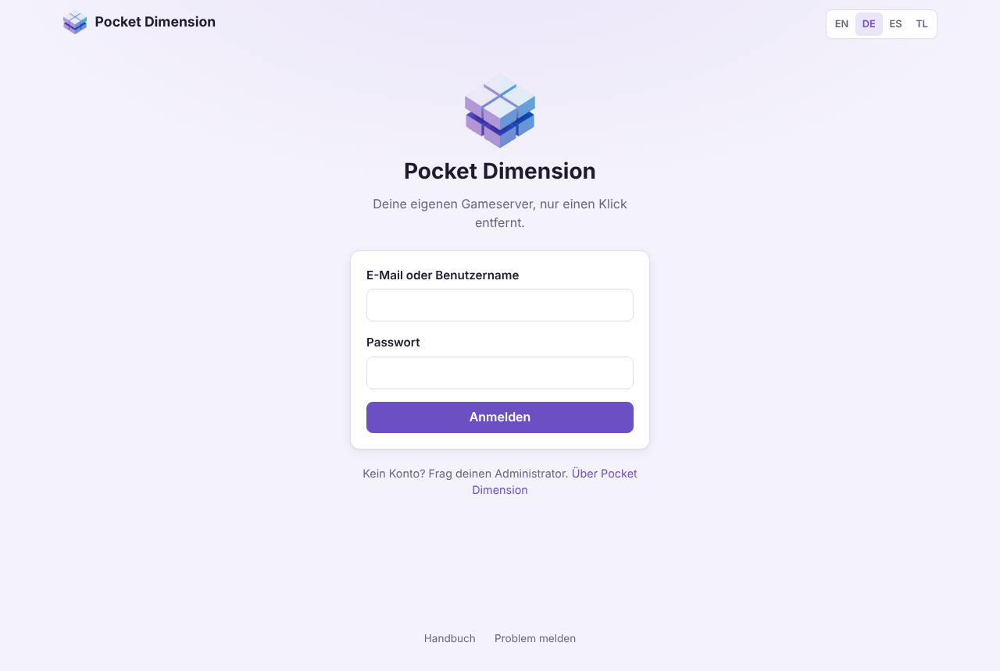
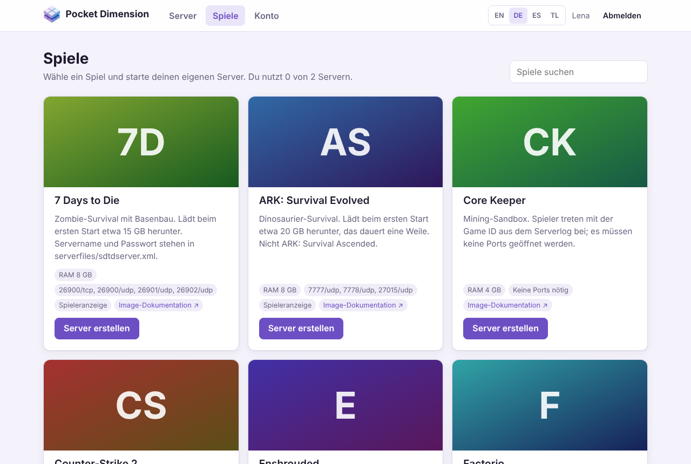
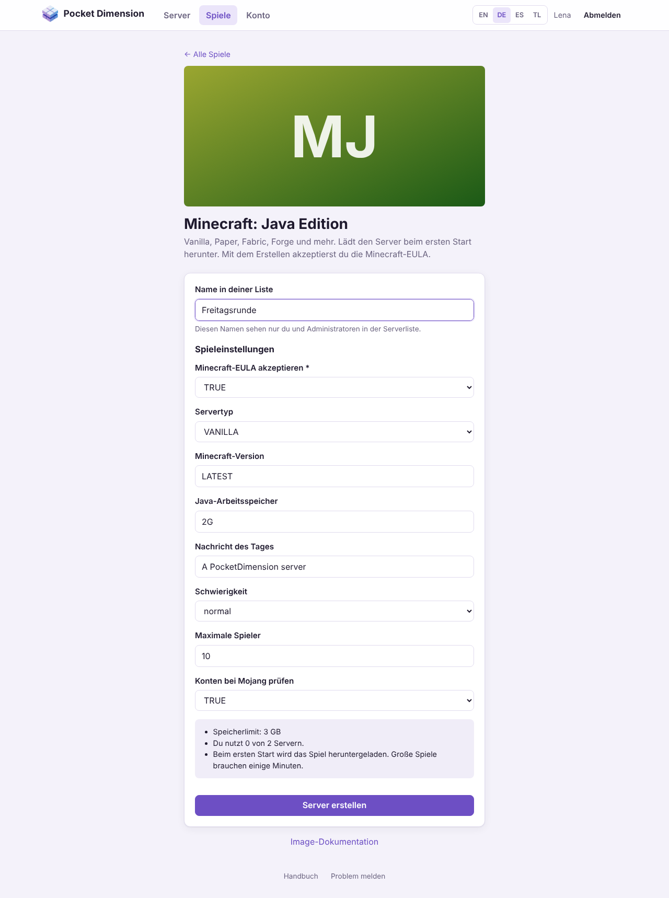
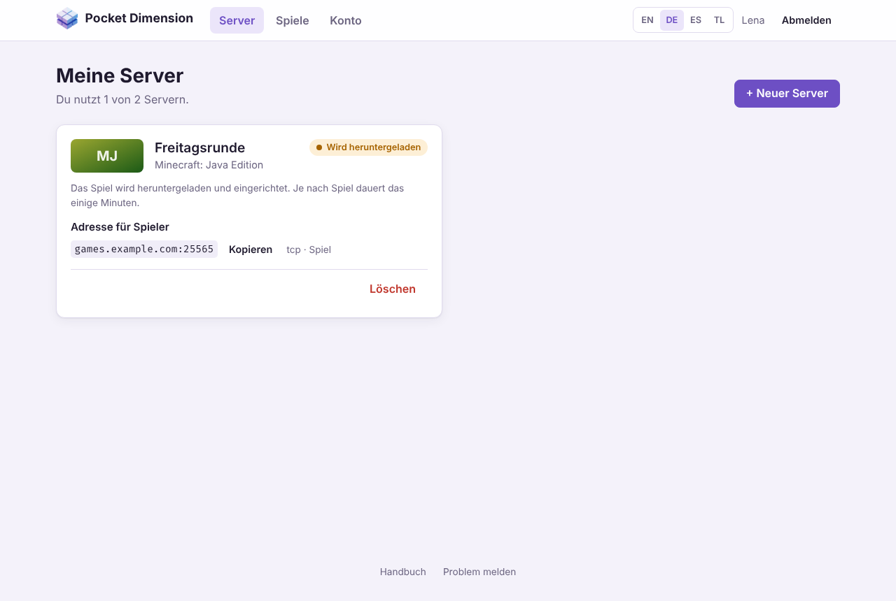
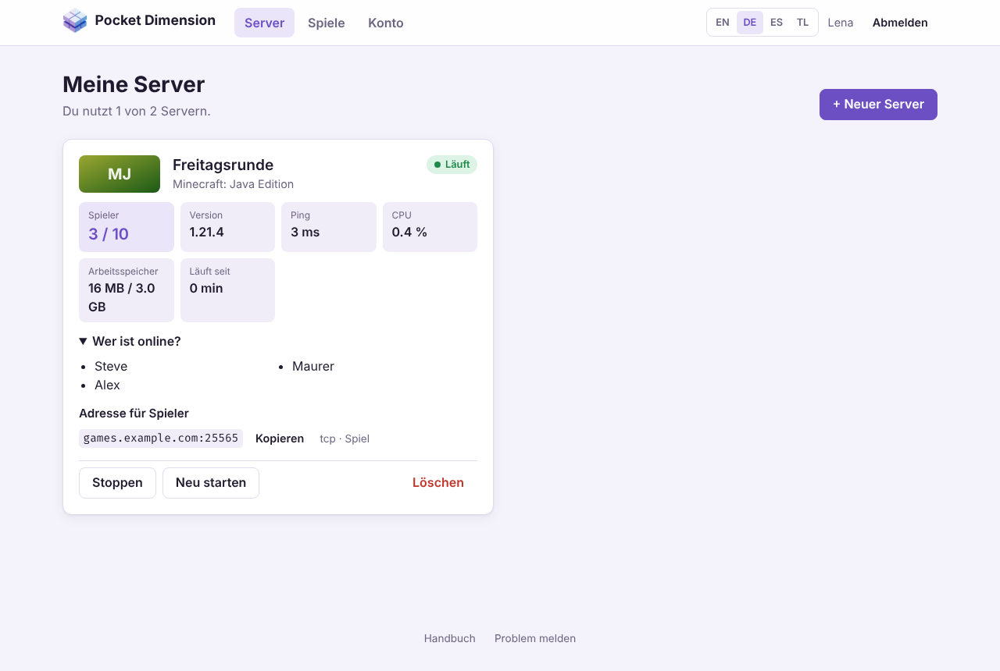
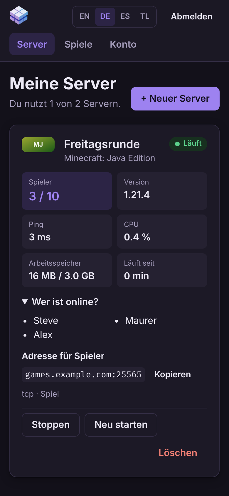
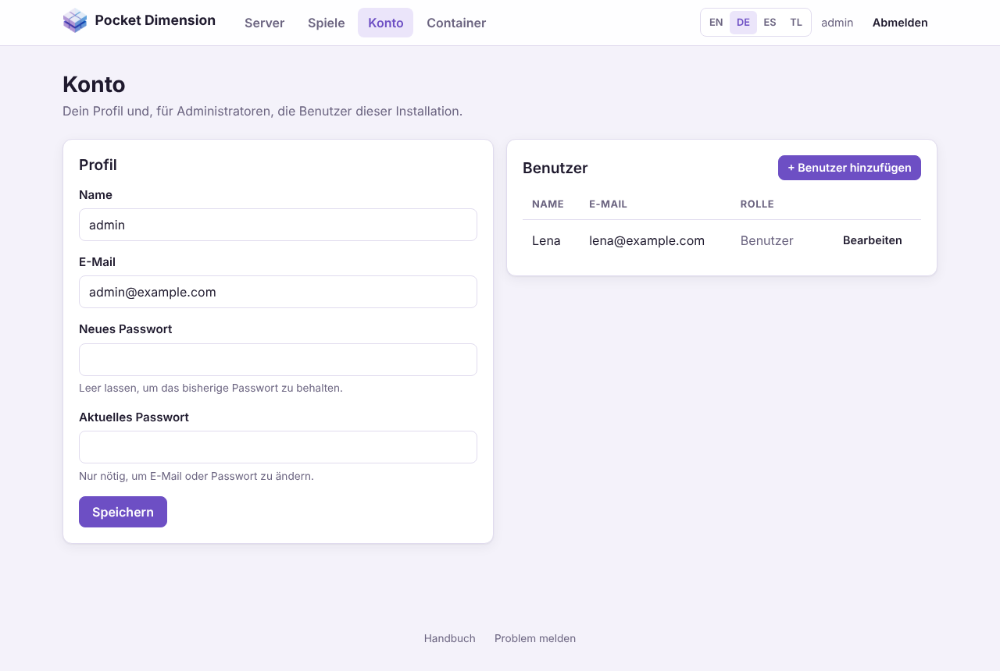
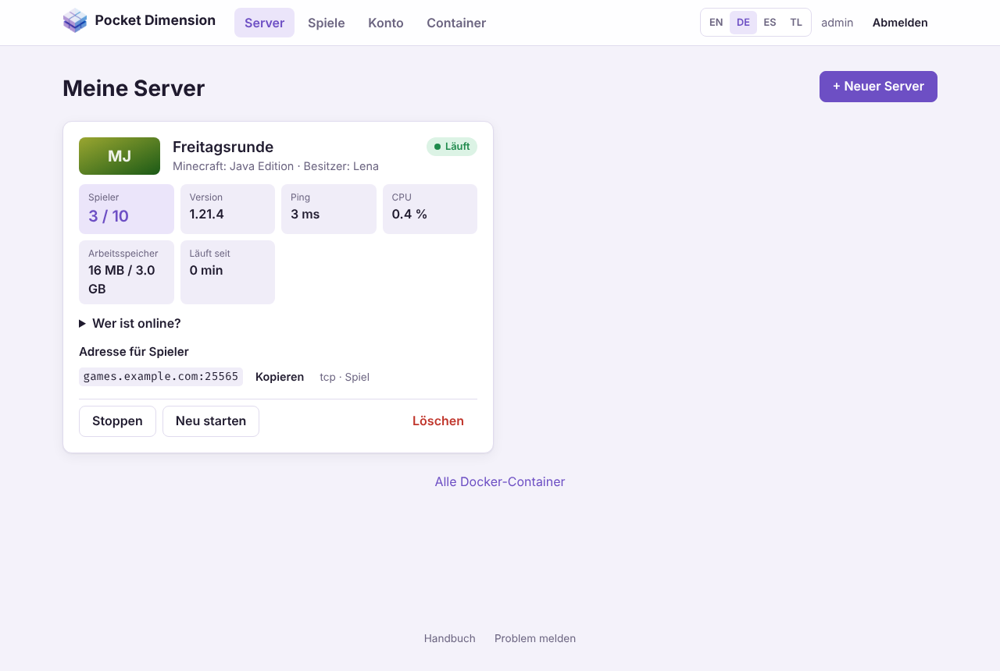
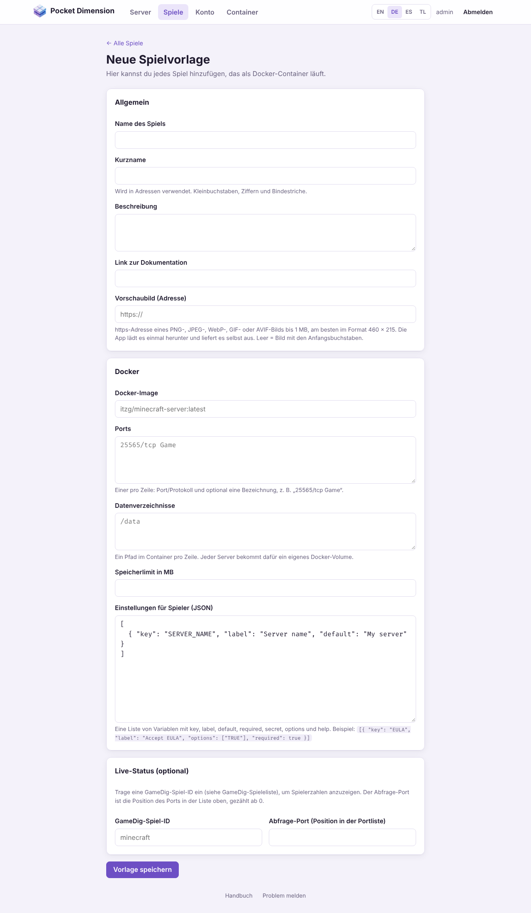
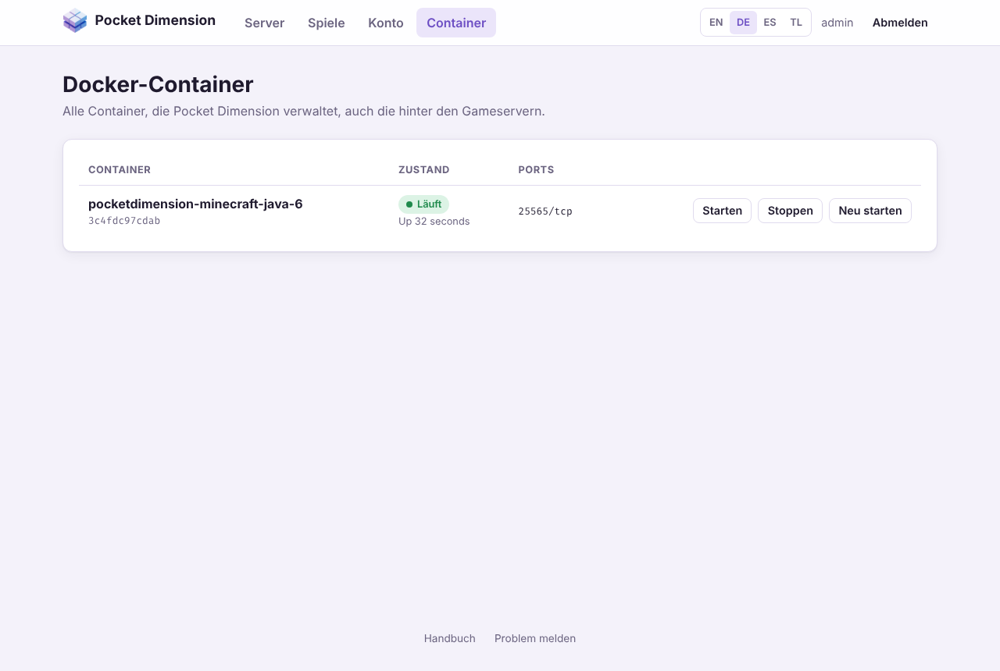

# Pocket Dimension – Benutzerhandbuch

[English](../en/user-manual.md) · **Deutsch** · [Español](../es/user-manual.md) ·
[Tagalog](../tl/user-manual.md)

Mit Pocket Dimension startest du deinen eigenen Gameserver im Browser: Spiel aussuchen, Namen
eingeben, fertig. Die App lädt das Spiel herunter, startet den Server und zeigt dir, wer gerade
spielt. Eine Kommandozeile brauchst du dafür nicht.

Dieses Handbuch erklärt die Bedienung der App, zuerst für alle Spieler, danach in
[Teil B](#teil-b--für-administratoren) die zusätzlichen Bereiche für Administratoren.
Wie man Pocket Dimension installiert und betreibt, steht im
[Bedienerhandbuch](operator-manual.md).

> Die Bilder in diesem Handbuch zeigen einen Testserver. Bei dir sehen Spiele und Adressen
> anders aus, und Spiele von Steam haben statt der Anfangsbuchstaben ihr Titelbild.

## Inhalt

- [Auf einen Blick](#auf-einen-blick)
- [Teil A – Für alle Spieler](#teil-a--für-alle-spieler)
  - [1. Anmelden](#1-anmelden)
  - [2. Ein Spiel aussuchen](#2-ein-spiel-aussuchen)
  - [3. Einen Server erstellen](#3-einen-server-erstellen)
  - [4. Meine Server](#4-meine-server)
  - [5. Freunde einladen](#5-freunde-einladen)
  - [6. Server starten, stoppen und löschen](#6-server-starten-stoppen-und-löschen)
  - [7. Konto und Passwort](#7-konto-und-passwort)
  - [8. Häufige Fragen](#8-häufige-fragen)
- [Teil B – Für Administratoren](#teil-b--für-administratoren)
  - [9. Benutzer verwalten](#9-benutzer-verwalten)
  - [10. Alle Server im Blick](#10-alle-server-im-blick)
  - [11. Spiele freigeben und anpassen](#11-spiele-freigeben-und-anpassen)
  - [12. Ein eigenes Spiel hinzufügen](#12-ein-eigenes-spiel-hinzufügen)
  - [13. Der gemeinsame Spielekatalog](#13-der-gemeinsame-spielekatalog)
  - [14. Container](#14-container)

---

## Auf einen Blick

1. **Anmelden** mit E-Mail oder Benutzername. Ein Konto bekommst du vom Administrator.
2. **Spiele** öffnen und beim gewünschten Spiel **Server erstellen** klicken.
3. Einen Namen eingeben, Einstellungen prüfen, **Server erstellen**.
4. Unter **Server** warten, bis dein Server **Läuft**.
5. Die **Adresse für Spieler** kopieren und an deine Freunde schicken.

Oben in jeder Seite findest du die Bereiche **Server**, **Spiele** und **Konto** (Administratoren
zusätzlich **Container**), rechts daneben die Sprachwahl **EN / DE / ES / TL** und **Abmelden**. Unten auf
jeder Seite führt **Handbuch** zu diesem Text und **Problem melden** zu den GitHub-Issues des
Projekts.

---

# Teil A – Für alle Spieler

## 1. Anmelden



Öffne die Adresse, die dir dein Administrator gegeben hat, zum Beispiel
`https://games.example.com` oder `http://192.168.0.10:3000`. Melde dich mit deiner **E-Mail oder
deinem Benutzernamen** und deinem **Passwort** an.

- **Kein Konto?** Selbst registrieren kann man sich nicht. Frag den Administrator der Installation.
- **Zu viele Fehlversuche:** Nach 10 falschen Passwörtern für dasselbe Konto sperrt die App weitere
  Versuche für bis zu 15 Minuten. Die Meldung nennt die Wartezeit.
- **Wie lange bleibe ich angemeldet?** Standardmäßig einen Tag. Danach meldest du dich neu an.
  Der Administrator kann die Dauer ändern.
- **Sprache:** Beim ersten Besuch übernimmt die App die Sprache deines Browsers (Englisch, Deutsch,
  Spanisch oder Tagalog; alles andere zeigt Englisch). Mit **EN / DE / ES / TL** oben rechts
  wechselst du sie; die App merkt sich deine Wahl.
- **Handy und dunkler Modus:** Die Oberfläche passt sich an kleine Bildschirme an und folgt dem
  hellen oder dunklen Modus deines Geräts.

Abmelden kannst du dich jederzeit oben rechts mit **Abmelden**.

## 2. Ein Spiel aussuchen



Unter **Spiele** siehst du alle Spiele, für die du einen Server starten kannst. Mit dem Feld
**Spiele suchen** filterst du nach Name und Beschreibung, zum Beispiel „mine“ für Minecraft.

Jede Karte zeigt:

| Angabe                    | Bedeutung                                                                                                                                                     |
| ------------------------- | ------------------------------------------------------------------------------------------------------------------------------------------------------------- |
| Beschreibung              | Was das Spiel ist und worauf du achten musst, etwa wie groß der Download ist.                                                                                 |
| **RAM**                   | So viel Arbeitsspeicher darf der Server höchstens nutzen.                                                                                                     |
| Ports (z. B. `25565/tcp`) | Über diese Ports verbinden sich die Spieler. **Keine Ports nötig** heißt, das Spiel verbindet sich anders (z. B. über eine Game ID).                          |
| **Spieleranzeige**        | Die App kann bei diesem Spiel anzeigen, wer online ist. Fehlt das Schild, siehst du nur, ob der Server läuft und wie viel CPU und Arbeitsspeicher er braucht. |
| **Image-Dokumentation**   | Die Anleitung zum Spiel-Image mit allen Einstellungen, falls du tiefer einsteigen willst.                                                                     |

Oben auf der Seite steht, wie viele Server du schon nutzt, zum Beispiel „Du nutzt 1 von 2 Servern“.

## 3. Einen Server erstellen



1. Klicke beim Spiel auf **Server erstellen**.
2. **Name in deiner Liste:** Ein Name, an dem du den Server erkennst, zum Beispiel
   „Freitagsrunde“ (2 bis 40 Zeichen). Diesen Namen sehen nur du und die Administratoren; im Spiel
   selbst heißt der Server so, wie du es in den Spieleinstellungen festlegst.
3. **Spieleinstellungen:** Was du hier einstellen kannst, legt die Spielvorlage fest, zum Beispiel
   Schwierigkeit, maximale Spielerzahl oder ein Serverpasswort.
   - Felder mit `*` sind Pflicht. Bei manchen Spielen musst du etwa ein Serverpasswort vergeben
     (Valheim, Team Fortress 2) oder ein Steam-Token eintragen (Counter-Strike 2). Die
     Beschreibung des Spiels sagt dir, woher du es bekommst.
   - Passwortfelder zeigen ihren Inhalt nicht an.
   - Felder mit einer Auswahlliste bieten nur die erlaubten Werte an.
   - Bei Minecraft akzeptierst du mit **TRUE** die Minecraft-EULA. Ohne startet der Server nicht.
4. Der Kasten unten fasst zusammen, wie viel Arbeitsspeicher der Server bekommt und wie viele Server
   du schon nutzt.
5. Klicke auf **Server erstellen**. Du landest unter **Server**.



Jetzt arbeitet die App im Hintergrund. Die Karte zeigt nacheinander **Wartet**, **Wird
heruntergeladen** und **Wird eingerichtet**. Beim ersten Server eines Spiels lädt der Rechner das
Spiel herunter; je nach Spiel und Leitung dauert das einige Minuten, bei Counter-Strike 2 (etwa
60 GB) auch deutlich länger. Du kannst die Seite in der Zwischenzeit schließen; der Server wird
trotzdem fertig.

**Serverlimit:** Spieler ohne Adminrechte dürfen nur eine begrenzte Zahl von Servern besitzen,
standardmäßig 2. Ist das Limit erreicht, verschwindet **Server erstellen** und die App bittet dich,
zuerst einen Server zu löschen. Gestoppte Server zählen mit.

## 4. Meine Server



Unter **Server** (Seite **Meine Server**) ist jeder deiner Server eine Karte. Die Seite
aktualisiert sich von selbst: während ein Server eingerichtet wird alle 3 Sekunden, sonst alle
15 Sekunden.

### Zustand

Das farbige Schild oben rechts zeigt, was der Server gerade tut:

| Zustand                  | Bedeutung                                                                                               |
| ------------------------ | ------------------------------------------------------------------------------------------------------- |
| **Wartet**               | Der Auftrag ist angekommen und startet gleich.                                                          |
| **Wird heruntergeladen** | Der Rechner lädt das Spiel herunter.                                                                    |
| **Wird eingerichtet**    | Der Server wird angelegt und das erste Mal gestartet.                                                   |
| **Läuft**                | Der Server ist an. Große Spiele brauchen danach oft noch ein paar Minuten, bis man sich verbinden kann. |
| **Gestoppt**             | Der Server ist aus. Die Spielwelt bleibt erhalten.                                                      |
| **Startet neu**          | Der Server wird gerade neu gestartet, oder er ist abgestürzt und Docker startet ihn erneut.             |
| **Abgestürzt**           | Der Server läuft nicht mehr und lässt sich nicht von selbst neu starten. Versuche **Starten**.          |
| **Fehler**               | Beim Einrichten ist etwas schiefgegangen. Die Meldung darunter nennt den Grund.                         |

### Live-Werte

Bei laufenden Servern zeigt die Karte:

- **Spieler:** wie viele Spieler verbunden sind und wie viele Plätze es gibt. Unter **Wer ist
  online?** stehen die Namen, wenn das Spiel sie verrät.
- **Karte**, **Version** und **Ping:** was der Server selbst über sich meldet. Nicht jedes Spiel
  meldet alles.
- **CPU** und **Arbeitsspeicher:** wie stark der Server den Rechner gerade belastet. Hinter dem
  Schrägstrich steht das Speicherlimit.
- **Läuft seit:** wie lange der Server schon an ist.

Spieler, Karte und Version gibt es nur bei Spielen mit **Spieleranzeige**. Das sind Minecraft (Java
und Bedrock), Valheim, Counter-Strike 2, Team Fortress 2, Rust, Project Zomboid, Satisfactory,
7 Days to Die, Enshrouded, V Rising, ARK: Survival Evolved, Sons of the Forest und OpenTTD.
Terraria, Factorio, Palworld, Core Keeper und Necesse zeigen nur CPU, Arbeitsspeicher und den
Zustand.

Steht dort **„Der Server antwortet noch nicht“**, startet das Spiel meist noch. Gib großen Spielen
beim ersten Start einige Minuten.

### Auf dem Handy



Auf dem Handy stehen die Werte untereinander. Alle Knöpfe funktionieren genauso wie am Rechner.

## 5. Freunde einladen

Unter **Adresse für Spieler** steht, womit sich deine Freunde verbinden, zum Beispiel
`games.example.com:25565`. Mit **Kopieren** landet die Adresse in der Zwischenablage, und du kannst
sie per Chat verschicken. Daneben steht, wofür der Port gedacht ist (z. B. `tcp · Game`).

- Deine Freunde geben die Adresse im Spiel beim Verbinden ein, meist unter „Direkt verbinden“,
  „Server hinzufügen“ oder in der Serversuche per IP.
- Hast du mehrere Server desselben Spiels, bekommt jeder eigene Ports. Der zweite Minecraft-Server
  hat dann zum Beispiel `:25575` statt `:25565`. Achte darauf, die richtige Adresse zu teilen.
- Hat ein Spiel ein Serverpasswort, gib es deinen Freunden zusätzlich zur Adresse. Die App zeigt
  Passwörter nach dem Erstellen nicht mehr an; notiere sie dir also.
- Spiele ohne Ports (z. B. Core Keeper) verbinden sich über eine Game ID aus dem Serverprotokoll.
  Die kann nur ein Administrator nachsehen; frag ihn danach.

Kommen deine Freunde nicht auf den Server, obwohl er **Läuft**, liegt es fast immer an der
Netzwerkfreigabe des Rechners. Das muss der Betreiber einrichten (siehe
[Bedienerhandbuch](operator-manual.md#8-fehlerbehebung)).

## 6. Server starten, stoppen und löschen

Unten auf jeder Karte findest du die Knöpfe. Welche erscheinen, hängt vom Zustand ab.

| Knopf                | Wann                | Wirkung                                                                                              |
| -------------------- | ------------------- | ---------------------------------------------------------------------------------------------------- |
| **Starten**          | Server ist gestoppt | Startet den Server. Die Spielwelt ist noch da.                                                       |
| **Stoppen**          | Server läuft        | Fährt den Server herunter. Das Spiel bekommt bis zu 30 Sekunden Zeit zum Speichern.                  |
| **Neu starten**      | Server läuft        | Stoppt und startet den Server, hilft oft bei Hängern.                                                |
| **Erneut versuchen** | Zustand **Fehler**  | Versucht das Einrichten noch einmal, zum Beispiel nach einem abgebrochenen Download.                 |
| **Löschen**          | immer               | Löscht den Server **mit allen Spielständen**. Die App fragt vorher nach. Nicht rückgängig zu machen. |

Gut zu wissen:

- Ein gestoppter Server belegt keinen Arbeitsspeicher, zählt aber weiter zu deinem Serverlimit.
- Startet der Rechner neu, laufen deine Server danach von selbst wieder an, sofern sie vorher
  liefen. Gestoppte Server bleiben aus.
- Einstellungen eines bestehenden Servers lassen sich nicht nachträglich ändern. Willst du etwas
  anderes einstellen, lösche den Server und lege ihn neu an (die Welt geht dabei verloren). Manche
  Spiele erlauben Änderungen auch im Spiel selbst oder über ihre Konfigurationsdateien; das kann der
  Administrator übernehmen.
- Einen Server sichern oder auf einen anderen Rechner umziehen kann nur der Betreiber.

## 7. Konto und Passwort

Unter **Konto → Profil** änderst du:

- **Name:** dein Benutzername zum Anmelden und für die Anzeige (2 bis 64 Zeichen).
- **E-Mail**
- **Neues Passwort:** mindestens 10 Zeichen. Leer lassen, um das bisherige zu behalten.

Für eine neue E-Mail oder ein neues Passwort gibst du zusätzlich dein **Aktuelles Passwort** ein.
Klicke dann auf **Speichern**.

Nach einem Passwortwechsel werden alle anderen Anmeldungen beendet, etwa auf einem anderen Gerät.
Das Gerät, an dem du das Passwort änderst, bleibt angemeldet.

**Passwort vergessen?** Eine „Passwort vergessen“-Funktion per E-Mail gibt es nicht. Ein
Administrator kann dir unter **Konto → Benutzer** ein neues Passwort setzen.

## 8. Häufige Fragen

**Mein Server hängt bei „Wird heruntergeladen“.**
Große Spiele brauchen beim ersten Mal lange. Der nächste Server desselben Spiels startet viel
schneller, weil das Spiel dann schon auf dem Rechner liegt. Bricht der Download ab, zeigt die Karte
**Fehler** und **Erneut versuchen**.

**Die Karte zeigt „Fehler“.**
Lies die Meldung auf der Karte und klicke **Erneut versuchen**. Kommt der Fehler wieder, gib die
Meldung an einen Administrator weiter.

**Oben steht „Docker ist nicht erreichbar“.**
Die App kommt gerade nicht an die Gameserver heran. Deine Server laufen meist trotzdem weiter. Sag
dem Betreiber Bescheid.

**Der Server läuft, aber meine Freunde kommen nicht drauf.**
Prüfe, ob sie die richtige Adresse samt Port verwenden und ob große Spiele schon fertig gestartet
sind (die Spieleranzeige zeigt dann Werte). Sonst sind meist die Ports im Router oder in der Firewall
des Rechners nicht freigegeben; das richtet der Betreiber ein.

**Die Spielerzahl stimmt nicht oder fehlt.**
Spieler, Karte und Version meldet das Spiel selbst. Manche Spiele melden sie verzögert oder gar
nicht. CPU und Arbeitsspeicher stimmen trotzdem.

**Ich sehe ein Spiel nicht, das ein Freund sieht.**
Jede Installation hat ihre eigene Auswahl. Ein Administrator kann Spiele freischalten oder neue
hinzufügen (siehe [Teil B](#teil-b--für-administratoren)).

**Mein Server ist weg.**
Ein Server verschwindet nur, wenn er gelöscht wurde. Administratoren können alle Server löschen;
frag nach.

**Ich habe einen Fehler in der App gefunden.**
Klicke unten auf der Seite auf **Problem melden** und beschreibe, was passiert ist.

---

# Teil B – Für Administratoren

Administratoren sehen alles, was Spieler sehen, und zusätzlich die folgenden Bereiche. Es gibt
kein Serverlimit für sie.

> Adminrechte bedeuten Zugriff auf Docker auf dem Rechner, auf dem Pocket Dimension läuft. Gib sie
> nur Personen, denen du auch den Rechner selbst anvertrauen würdest (siehe
> [Bedienerhandbuch, Abschnitt 4.5](operator-manual.md#45-was-die-app-absichert-und-was-nicht)).

## 9. Benutzer verwalten



Unter **Konto** steht neben deinem Profil die Liste **Benutzer** mit allen anderen Konten.

- **Benutzer hinzufügen:** Name, E-Mail und Passwort (mindestens 10 Zeichen) eingeben. Mit dem
  Haken **Administrator** bekommt das Konto Adminrechte. Gib dem neuen Benutzer anschließend die
  Adresse der App, seinen Namen und das Passwort; er kann das Passwort danach selbst ändern.
- **Bearbeiten:** Name, E-Mail, Passwort oder die Adminrolle eines Benutzers ändern. Ein neues
  Passwort meldet den Benutzer auf allen Geräten ab.
- Dein eigenes Konto bearbeitest du über **Profil**, nicht in dieser Liste. So kannst du dir nicht
  versehentlich selbst die Adminrechte nehmen.
- Konten lassen sich nicht löschen. Um jemanden auszusperren, setze ein neues, unbekanntes Passwort.
  Seine Server bleiben bestehen, bis du sie löschst.

## 10. Alle Server im Blick



Unter **Server** siehst du als Administrator die Server **aller** Benutzer. Hinter dem Spielnamen
steht der **Besitzer**. Du kannst jeden Server starten, stoppen, neu starten und löschen, etwa wenn
ein Server den Rechner ausbremst oder ein Spieler nicht mehr mitspielt.

Unten auf der Seite führt **Alle Docker-Container** zur Seite **Container** (siehe
[Abschnitt 14](#14-container)).

## 11. Spiele freigeben und anpassen

Auf jeder Spielkarte unter **Spiele** gibt es für dich zwei zusätzliche Knöpfe:

- **Deaktivieren / Aktivieren:** Deaktivierte Spiele sehen Spieler nicht mehr, und niemand kann neue
  Server damit erstellen. Du siehst sie weiter mit dem Schild **Deaktiviert**. Bestehende Server des
  Spiels laufen weiter.
- **Bearbeiten:** öffnet die Spielvorlage mit allen Feldern (siehe
  [Abschnitt 12](#12-ein-eigenes-spiel-hinzufügen)).

Spiele aus dem gemeinsamen Katalog (siehe [Abschnitt 13](#13-der-gemeinsame-spielekatalog))
bekommen Updates von dort. Was du an ihnen änderst, wird überschrieben, sobald eine neuere Version
des Spiels kommt; die Bearbeiten-Seite weist darauf hin. Willst du ein Katalogspiel dauerhaft
anders, lege eine eigene Vorlage mit anderem Kurznamen an. Katalogspiele lassen sich nicht löschen,
nur deaktivieren.

Eigene Vorlagen kannst du auf ihrer Bearbeiten-Seite mit **Vorlage löschen** entfernen, solange
kein Server sie nutzt.

Änderungen an einer Vorlage gelten nur für **neue** Server. Bestehende Server behalten Image,
Ports und Einstellungen, mit denen sie erstellt wurden.

## 12. Ein eigenes Spiel hinzufügen



Jedes Spiel, für das es ein Docker-Image gibt, lässt sich hinzufügen: **Spiele → + Neue
Spielvorlage**. Die nötigen Angaben findest du in der Beschreibung des Images, meist auf
[Docker Hub](https://hub.docker.com) oder GitHub.

**Allgemein**

| Feld                   | Beispiel                                                  | Bedeutung                                                                                                                                                                      |
| ---------------------- | --------------------------------------------------------- | ------------------------------------------------------------------------------------------------------------------------------------------------------------------------------ |
| Name des Spiels        | `Minecraft Bedrock`                                       | So erscheint das Spiel im Katalog.                                                                                                                                             |
| Kurzname               | `minecraft-bedrock`                                       | Teil der Adresse und eindeutig; Kleinbuchstaben, Ziffern, Bindestriche.                                                                                                        |
| Beschreibung           | `Bedrock-Server für Handy und Konsole.`                   | Hinweise für Spieler: Downloadgröße, Pflichtfelder, wie man sich verbindet.                                                                                                    |
| Link zur Dokumentation | `https://github.com/itzg/docker-minecraft-bedrock-server` | Erscheint auf der Karte als **Image-Dokumentation**.                                                                                                                           |
| Vorschaubild (Adresse) | `https://…/header.jpg`                                    | Optional. https-Adresse eines Bilds (PNG, JPEG, WebP, GIF oder AVIF, höchstens 1 MB, ideal 460 × 215). Die App lädt es einmal herunter. Leer = Bild mit den Anfangsbuchstaben. |

**Docker**

| Feld                             | Beispiel                               | Bedeutung                                                                                                                                                                                 |
| -------------------------------- | -------------------------------------- | ----------------------------------------------------------------------------------------------------------------------------------------------------------------------------------------- |
| Docker-Image                     | `itzg/minecraft-bedrock-server:latest` | Image auf Docker Hub oder einer anderen Registry.                                                                                                                                         |
| Ports                            | `19132/udp Game`                       | Ein Port pro Zeile: Port im Container, Protokoll (`tcp` oder `udp`), optional eine Bezeichnung.                                                                                           |
| Datenverzeichnisse               | `/data`                                | Pfade im Container, in denen das Spiel Welten und Einstellungen speichert. Jeder Server bekommt dafür ein eigenes Volume. Trage alle Verzeichnisse ein, die das Image als `VOLUME` nennt. |
| Speicherlimit in MB              | `2048`                                 | Mehr Arbeitsspeicher darf ein Server nicht nutzen.                                                                                                                                        |
| Einstellungen für Spieler (JSON) | siehe unten                            | Was Spieler beim Erstellen einstellen dürfen.                                                                                                                                             |

**Live-Status (optional)**

| Feld                                     | Beispiel | Bedeutung                                                                                                                                                                                                      |
| ---------------------------------------- | -------- | -------------------------------------------------------------------------------------------------------------------------------------------------------------------------------------------------------------- |
| GameDig-Spiel-ID                         | `mbe`    | Damit zeigt die App Spielerzahl, Karte und Version. Die ID steht in der [GameDig-Spieleliste](https://github.com/gamedig/node-gamedig/blob/master/GAMES_LIST.md). Leer = nur CPU, Arbeitsspeicher und Zustand. |
| Abfrage-Port (Position in der Portliste) | `0`      | Welcher Port aus der Liste oben auf Abfragen antwortet, gezählt ab 0. Viele Steam-Spiele haben dafür einen eigenen Port.                                                                                       |

**Einstellungen für Spieler** sind eine Liste von Umgebungsvariablen des Images:

```json
[
	{ "key": "EULA", "label": "Accept the EULA", "options": ["TRUE"], "required": true },
	{ "key": "SERVER_NAME", "label": "Server name", "default": "Unser Server" },
	{
		"key": "LEVEL_TYPE",
		"label": "World type",
		"options": ["DEFAULT", "FLAT"],
		"default": "DEFAULT"
	},
	{ "key": "PASSWORD", "label": "Server password", "secret": true, "help": "Leer = ohne Passwort" }
]
```

| Schlüssel  | Bedeutung                              |
| ---------- | -------------------------------------- |
| `key`      | Name der Umgebungsvariable des Images. |
| `label`    | Beschriftung im Formular.              |
| `default`  | Vorbelegung.                           |
| `required` | Spieler müssen einen Wert eingeben.    |
| `secret`   | Eingabe als Passwortfeld.              |
| `options`  | Auswahlliste statt freiem Text.        |
| `help`     | Hinweis unter dem Feld.                |

Tipps:

- Spieler können nur die hier aufgeführten Variablen setzen. Image, Ports, Datenverzeichnisse und
  Speicherlimit legst allein du fest.
- Leere Werte werden nicht an das Image übergeben; dann gilt die Voreinstellung des Images. Hat ein
  Image ein bekanntes Standardpasswort (etwa für RCON), mach das Feld zur Pflicht.
- Spielvorlagen dürfen keine Ordner des Rechners, keinen Docker-Socket und keine Sonderrechte
  einbinden. Spiele, die so etwas brauchen, lassen sich nicht hinzufügen.
- Teste ein neues Spiel mit einem eigenen Server, bevor du es für alle freigibst.

Die Oberfläche zeigt die Beschriftungen der Spiele aus dem gemeinsamen Katalog übersetzt auf
Deutsch, Spanisch und Tagalog. Beschriftungen eigener Spiele erscheinen so, wie du sie einträgst.

**Für alle teilen:** Unten auf der Bearbeiten-Seite lädt **Für den Katalog exportieren** das Spiel
als Datei `<kurzname>.json` herunter. Wie du es damit in den gemeinsamen Katalog bringst, steht in
[`catalog/README.md`](../../catalog/README.md).

## 13. Der gemeinsame Spielekatalog

Alle Pocket-Dimension-Installationen teilen sich einen öffentlichen Spielekatalog im Ordner
[`catalog/`](../../catalog/) des Projekts. Die App lädt ihn nur lesend herunter, ohne Konto, ohne
Schlüssel und ohne Daten über deine Installation zu senden.

Oben auf der Seite **Spiele** siehst du, wann der Katalog zuletzt geprüft wurde und was dabei
passiert ist: wie viele Spiele neu dazukamen und wie viele aktualisiert wurden. Mit **Katalog
aktualisieren** fragst du ihn sofort ab. Sonst prüft die App ihn beim Start und danach einmal am
Tag.

- **Neue Spiele** aus dem Katalog kommen **deaktiviert** an. Erst wenn du sie aktivierst, sehen
  Spieler sie. So entscheidest du selbst, was auf deinem Rechner läuft.
- **Neuere Versionen** bekannter Spiele (anderes Image, neue Einstellungen) werden übernommen.
  Ob ein Spiel aktiviert ist, bleibt dabei erhalten.
- **Eigene Spiele** werden nie überschrieben. Hat ein Katalogspiel denselben Kurznamen wie eines
  deiner Spiele, wird es übersprungen und als solches aufgeführt.
- **Ungültige Einträge** lässt die App aus und nennt ihre Zahl.
- Steht dort „Der gemeinsame Spielekatalog ist ausgeschaltet“, hat der Betreiber ihn abgeschaltet.
  Es gibt dann nur die mit der App ausgelieferten Spiele und deine eigenen.

## 14. Container



**Container** zeigt alle Docker-Container, die Pocket Dimension verwaltet, mit Zustand und Ports.
Der Containername eines Gameservers hat die Form `pocketdimension-<kurzname>-<nummer>`. Ihn
braucht der Betreiber, um zum Beispiel mit `docker logs <containername>` das Protokoll eines Spiels
anzusehen (etwa für die Game ID von Core Keeper oder für Fehlermeldungen).

Mit **Starten**, **Stoppen** und **Neu starten** steuerst du Container direkt, auch solche, die
nicht als Server in der Serverliste stehen. Für normale Gameserver ist die Serverliste der
bequemere Weg.

---

Fehlt dir etwas in diesem Handbuch oder stimmt etwas nicht? Melde es unter
[github.com/damaurer/PocketDimension/issues](https://github.com/damaurer/PocketDimension/issues).
