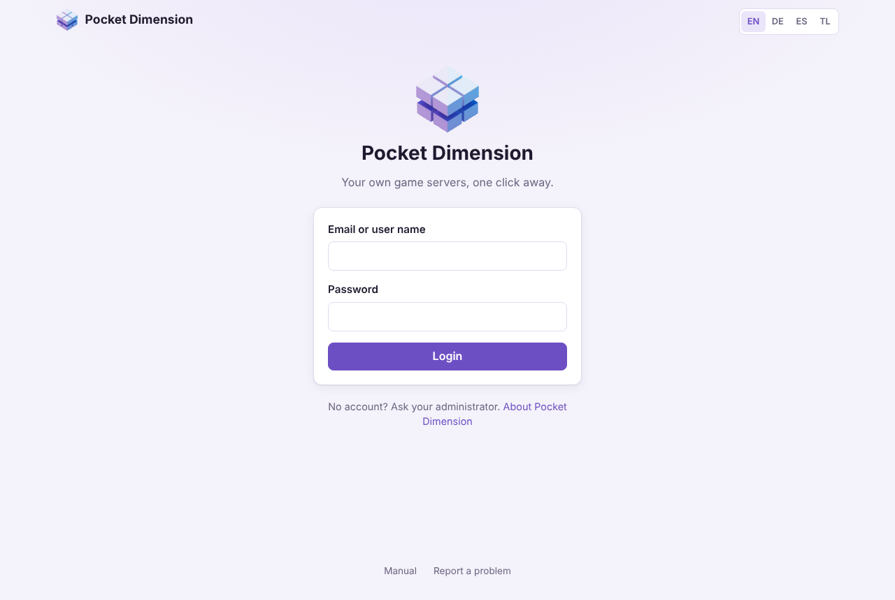
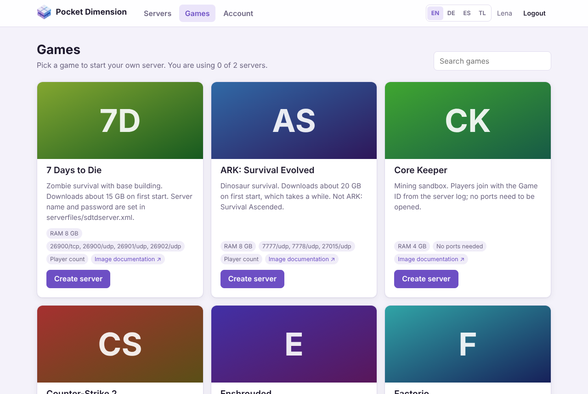
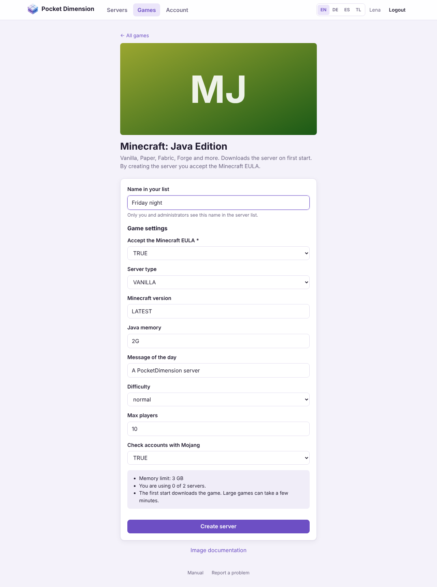
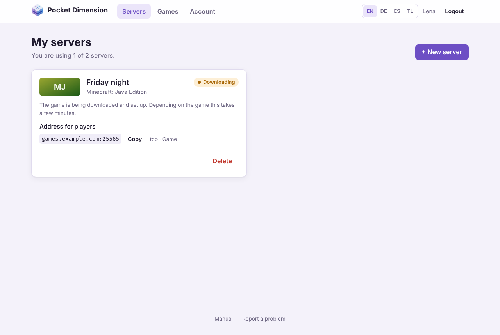
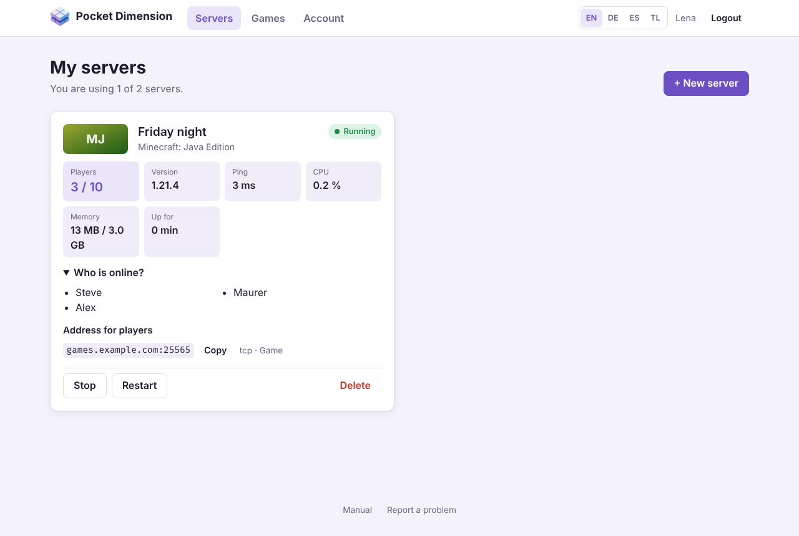
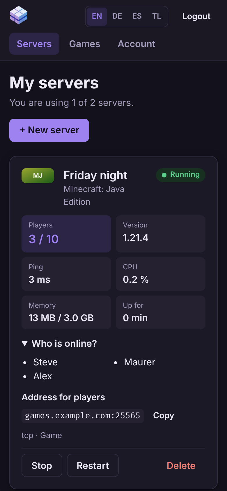
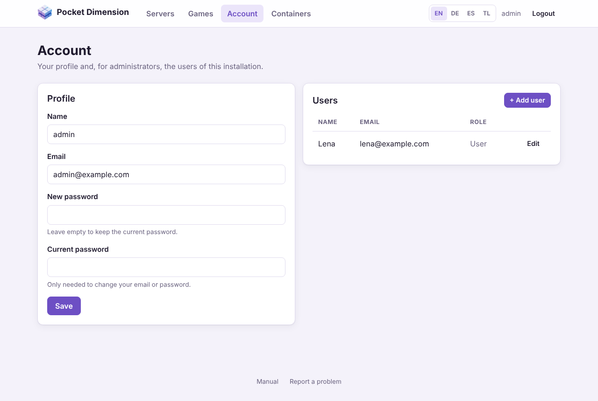
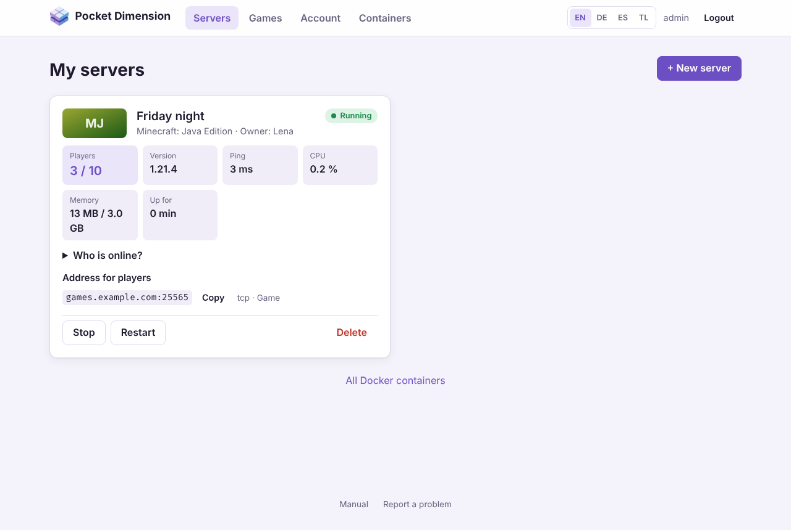
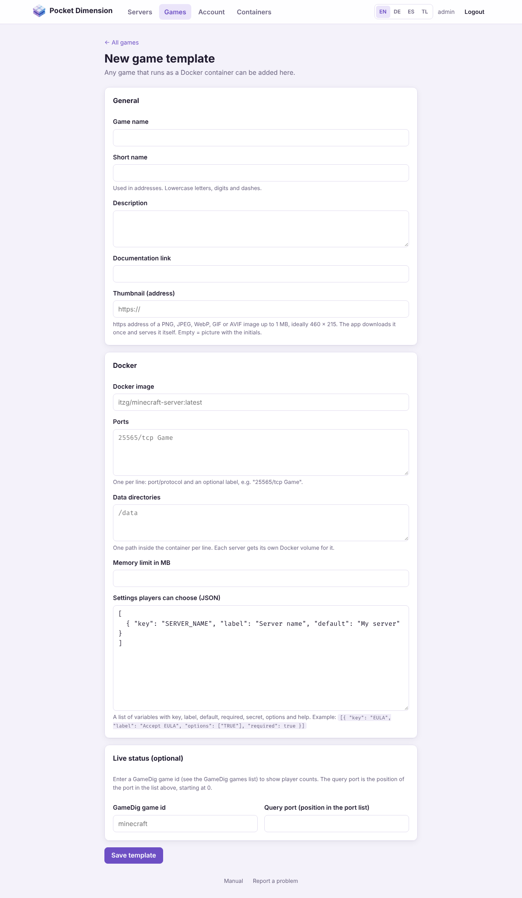
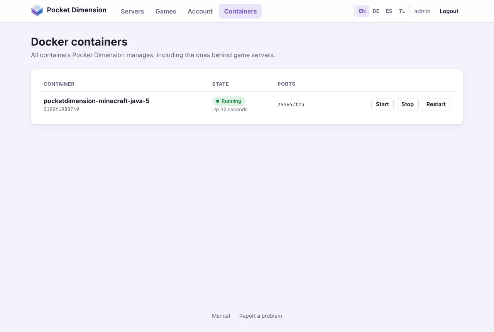

# Pocket Dimension – User manual

**English** · [Deutsch](../de/user-manual.md) · [Español](../es/user-manual.md) ·
[Tagalog](../tl/user-manual.md)

Pocket Dimension lets you start your own game server in the browser: pick a game, enter a name,
done. The app downloads the game, starts the server and shows you who is playing. You never need a
command line.

This manual explains how to use the app, first for all players, then, in
[Part B](#part-b--for-administrators), the extra areas for administrators. How to install and run
Pocket Dimension is described in the [operator manual](operator-manual.md).

> The pictures in this manual show a test server. Your games and addresses will look different,
> and games from Steam show their cover picture instead of the initials.

## Contents

- [At a glance](#at-a-glance)
- [Part A – For all players](#part-a--for-all-players)
  - [1. Logging in](#1-logging-in)
  - [2. Choosing a game](#2-choosing-a-game)
  - [3. Creating a server](#3-creating-a-server)
  - [4. My servers](#4-my-servers)
  - [5. Inviting friends](#5-inviting-friends)
  - [6. Starting, stopping and deleting servers](#6-starting-stopping-and-deleting-servers)
  - [7. Account and password](#7-account-and-password)
  - [8. Frequently asked questions](#8-frequently-asked-questions)
- [Part B – For administrators](#part-b--for-administrators)
  - [9. Managing users](#9-managing-users)
  - [10. All servers at a glance](#10-all-servers-at-a-glance)
  - [11. Enabling and adjusting games](#11-enabling-and-adjusting-games)
  - [12. Adding your own game](#12-adding-your-own-game)
  - [13. The shared game catalog](#13-the-shared-game-catalog)
  - [14. Containers](#14-containers)

---

## At a glance

1. **Log in** with your email or user name. Your administrator gives you an account.
2. Open **Games** and click **Create server** on the game you want.
3. Enter a name, check the settings, click **Create server**.
4. Under **Servers**, wait until your server is **Running**.
5. Copy the **Address for players** and send it to your friends.

At the top of every page you find **Servers**, **Games** and **Account** (administrators also see
**Containers**), and on the right the language switch **EN / DE / ES / TL** and **Logout**. At
the bottom of every page, **Manual** opens this text and **Report a problem** opens the project's
GitHub issues.

---

# Part A – For all players

## 1. Logging in



Open the address your administrator gave you, for example `https://games.example.com` or
`http://192.168.0.10:3000`. Log in with your **email or user name** and your **password**.

- **No account?** You cannot sign up yourself. Ask the administrator of the installation.
- **Too many failed attempts:** after 10 wrong passwords for the same account, the app blocks
  further attempts for up to 15 minutes. The message tells you how long to wait.
- **How long do I stay logged in?** One day by default. After that you log in again. The
  administrator can change this.
- **Language:** on your first visit the app uses your browser's language (English, German,
  Spanish or Tagalog; anything else shows English). Switch it with **EN / DE / ES / TL** at the top
  right; the app remembers your choice.
- **Phone and dark mode:** the interface adapts to small screens and follows your device's light
  or dark mode.

You can log out at any time with **Logout** at the top right.

## 2. Choosing a game



**Games** lists every game you can start a server for. The **Search games** field filters by name
and description, for example "mine" for Minecraft.

Each card shows:

| Item                     | Meaning                                                                                                                                        |
| ------------------------ | ---------------------------------------------------------------------------------------------------------------------------------------------- |
| Description              | What the game is and what to watch out for, such as the download size.                                                                         |
| **RAM**                  | The most memory the server may use.                                                                                                            |
| Ports (e.g. `25565/tcp`) | Players connect through these ports. **No ports needed** means the game connects differently (e.g. with a Game ID).                            |
| **Player count**         | The app can show who is online for this game. Without this tag you only see whether the server is running and how much CPU and memory it uses. |
| **Image documentation**  | The guide for the game image with all its settings, if you want to dig deeper.                                                                 |

At the top of the page you see how many servers you already use, for example "You are using 1 of
2 servers."

## 3. Creating a server



1. Click **Create server** on the game.
2. **Name in your list:** a name you recognise the server by, for example "Friday night" (2 to 40
   characters). Only you and administrators see this name; inside the game the server is called
   whatever you set in the game settings.
3. **Game settings:** what you can set here is defined by the game template, for example
   difficulty, maximum players or a server password.
   - Fields marked `*` are required. Some games need a server password (Valheim, Team Fortress 2)
     or a Steam token (Counter-Strike 2). The game's description tells you where to get it.
   - Password fields hide what you type.
   - Fields with a drop-down list only offer the allowed values.
   - For Minecraft, **TRUE** accepts the Minecraft EULA. Without it the server does not start.
4. The box at the bottom sums up how much memory the server gets and how many servers you already
   use.
5. Click **Create server**. You land under **Servers**.



The app now works in the background. The card shows **Waiting**, **Downloading** and **Setting
up** in turn. The first server of a game makes the machine download the game; depending on the
game and the connection this takes a few minutes, for Counter-Strike 2 (about 60 GB) much longer.
You can close the page in the meantime; the server is finished anyway.

**Server limit:** players without admin rights may own a limited number of servers, 2 by default.
Once you reach the limit, **Create server** disappears and the app asks you to delete a server
first. Stopped servers count too.

## 4. My servers



Under **Servers** (page **My servers**) each of your servers is a card. The page refreshes by
itself: every 3 seconds while a server is being set up, otherwise every 15 seconds.

### State

The coloured tag at the top right shows what the server is doing:

| State           | Meaning                                                                           |
| --------------- | --------------------------------------------------------------------------------- |
| **Waiting**     | The request has arrived and starts in a moment.                                   |
| **Downloading** | The machine is downloading the game.                                              |
| **Setting up**  | The server is being created and started for the first time.                       |
| **Running**     | The server is on. Big games often need a few more minutes before you can connect. |
| **Stopped**     | The server is off. The game world is kept.                                        |
| **Restarting**  | The server is restarting, or it crashed and Docker starts it again.               |
| **Crashed**     | The server is no longer running and cannot restart by itself. Try **Start**.      |
| **Error**       | Something went wrong while setting it up. The message below explains why.         |

### Live values

For running servers the card shows:

- **Players:** how many players are connected and how many slots there are. **Who is online?**
  lists their names if the game reveals them.
- **Map**, **Version** and **Ping:** what the server reports about itself. Not every game reports
  everything.
- **CPU** and **Memory:** how much load the server puts on the machine right now. After the slash
  you see the memory limit.
- **Up for:** how long the server has been on.

Players, map and version are only available for games with **Player count**. These are Minecraft
(Java and Bedrock), Valheim, Counter-Strike 2, Team Fortress 2, Rust, Project Zomboid, Satisfactory,
7 Days to Die, Enshrouded, V Rising, ARK: Survival Evolved, Sons of the Forest and OpenTTD.
Terraria, Factorio, Palworld, Core Keeper and Necesse only show CPU, memory and the state.

If it says **"The server is not answering yet"**, the game is usually still starting. Give big games
a few minutes on their first start.

### On a phone



On a phone the values are stacked. All buttons work just like on a computer.

## 5. Inviting friends

**Address for players** shows what your friends connect to, for example `games.example.com:25565`.
**Copy** puts the address on the clipboard so you can send it in a chat. Next to it you see what
the port is for (e.g. `tcp · Game`).

- Your friends enter the address in the game when connecting, usually under "Direct connect",
  "Add server" or the server search by IP.
- If you have several servers of the same game, each gets its own ports. A second Minecraft
  server then has `:25575` instead of `:25565`, for example. Make sure you share the right address.
- If a game has a server password, give it to your friends together with the address. The app
  does not show passwords again after creation, so write them down.
- Games without ports (e.g. Core Keeper) connect with a Game ID from the server log. Only an
  administrator can look it up; ask them for it.

If your friends cannot get onto the server even though it is **Running**, it is almost always the
network setup of the machine. The operator has to fix that (see the
[operator manual](operator-manual.md#8-troubleshooting)).

## 6. Starting, stopping and deleting servers

The buttons are at the bottom of each card. Which ones appear depends on the state.

| Button        | When              | Effect                                                                            |
| ------------- | ----------------- | --------------------------------------------------------------------------------- |
| **Start**     | Server is stopped | Starts the server. The game world is still there.                                 |
| **Stop**      | Server is running | Shuts the server down. The game gets up to 30 seconds to save.                    |
| **Restart**   | Server is running | Stops and starts the server, often helps when it hangs.                           |
| **Try again** | State **Error**   | Tries the setup once more, for example after an interrupted download.             |
| **Delete**    | Always            | Deletes the server **with all saves**. The app asks first. This cannot be undone. |

Good to know:

- A stopped server uses no memory but still counts towards your server limit.
- When the machine restarts, your servers start again by themselves if they were running before.
  Stopped servers stay off.
- The settings of an existing server cannot be changed afterwards. To set something else, delete
  the server and create it again (the world is lost). Some games allow changes in the game itself
  or in their configuration files; an administrator can take care of that.
- Only the operator can back up a server or move it to another machine.

## 7. Account and password

Under **Account → Profile** you change:

- **Name:** your user name for logging in and for display (2 to 64 characters).
- **Email**
- **New password:** at least 10 characters. Leave it empty to keep the current one.

For a new email or a new password you also enter your **Current password**. Then click **Save**.

Changing your password logs you out everywhere else, for example on another device. The device
you change it on stays logged in.

**Forgot your password?** There is no "forgot password" by email. An administrator can set a new
password for you under **Account → Users**.

## 8. Frequently asked questions

**My server is stuck at "Downloading".**
Big games take a long time the first time. The next server of the same game starts much faster
because the game is already on the machine. If the download fails, the card shows **Error** and
**Try again**.

**The card shows "Error".**
Read the message on the card and click **Try again**. If the error comes back, pass the message on
to an administrator.

**The top of the page says "Docker is not reachable".**
The app cannot reach the game servers right now. Your servers usually keep running anyway. Tell the
operator.

**The server is running, but my friends cannot get in.**
Check that they use the right address including the port, and that big games have finished
starting (the player count then shows values). Otherwise the ports are usually not open in the
router or in the machine's firewall; the operator sets that up.

**The player count is wrong or missing.**
Players, map and version are reported by the game itself. Some games report them late or not at
all. CPU and memory are still correct.

**I cannot see a game a friend can see.**
Every installation has its own selection. An administrator can enable games or add new ones (see
[Part B](#part-b--for-administrators)).

**My server is gone.**
A server only disappears when it was deleted. Administrators can delete any server; ask them.

**I found a bug in the app.**
Click **Report a problem** at the bottom of the page and describe what happened.

---

# Part B – For administrators

Administrators see everything players see, plus the following areas. They have no server limit.

> Admin rights mean access to Docker on the machine Pocket Dimension runs on. Only give them to
> people you would trust with the machine itself (see the
> [operator manual, section 4.5](operator-manual.md#45-what-the-app-protects-and-what-it-does-not)).

## 9. Managing users



Under **Account**, next to your profile, the **Users** list shows all other accounts.

- **Add user:** enter name, email and password (at least 10 characters). Tick **Administrator** to
  give the account admin rights. Then give the new user the app's address, their name and the
  password; they can change the password themselves afterwards.
- **Edit:** change a user's name, email, password or admin role. A new password logs the user out
  on all devices.
- You edit your own account under **Profile**, not in this list. That way you cannot accidentally
  remove your own admin rights.
- Accounts cannot be deleted. To lock someone out, set a new password they do not know. Their
  servers stay until you delete them.

## 10. All servers at a glance



As an administrator you see **all** users' servers under **Servers**. After the game name you see
the **Owner**. You can start, stop, restart and delete any server, for example when a server slows
down the machine or a player no longer takes part.

At the bottom of the page, **All Docker containers** leads to the **Containers** page (see
[section 14](#14-containers)).

## 11. Enabling and adjusting games

Every game card under **Games** has two extra buttons for you:

- **Disable / Enable:** players no longer see disabled games, and nobody can create new servers with
  them. You still see them with the **Disabled** tag. Existing servers of the game keep running.
- **Edit:** opens the game template with all its fields (see
  [section 12](#12-adding-your-own-game)).

Games from the shared catalog (see [section 13](#13-the-shared-game-catalog)) receive updates
from there. Whatever you change on them is overwritten as soon as a newer version of the game
arrives; the edit page points this out. To keep a catalog game permanently different, create your
own template with a different short name. Catalog games cannot be deleted, only disabled.

You can remove your own templates with **Delete template** on their edit page, as long as no
server uses them.

Changes to a template only apply to **new** servers. Existing servers keep the image, ports and
settings they were created with.

## 12. Adding your own game



Any game with a Docker image can be added: **Games → + New game template**. You usually find the
details in the image's description on [Docker Hub](https://hub.docker.com) or GitHub.

**General**

| Field               | Example                                                   | Meaning                                                                                                                                                         |
| ------------------- | --------------------------------------------------------- | --------------------------------------------------------------------------------------------------------------------------------------------------------------- |
| Game name           | `Minecraft Bedrock`                                       | How the game appears in the catalog.                                                                                                                            |
| Short name          | `minecraft-bedrock`                                       | Part of the address and unique; lowercase letters, digits, dashes.                                                                                              |
| Description         | `Bedrock server for phones and consoles.`                 | Hints for players: download size, required fields, how to connect.                                                                                              |
| Documentation link  | `https://github.com/itzg/docker-minecraft-bedrock-server` | Shown on the card as **Image documentation**.                                                                                                                   |
| Thumbnail (address) | `https://…/header.jpg`                                    | Optional. https address of a picture (PNG, JPEG, WebP, GIF or AVIF, at most 1 MB, ideally 460 × 215). The app downloads it once. Empty = picture with initials. |

**Docker**

| Field                              | Example                                | Meaning                                                                                                                                                              |
| ---------------------------------- | -------------------------------------- | -------------------------------------------------------------------------------------------------------------------------------------------------------------------- |
| Docker image                       | `itzg/minecraft-bedrock-server:latest` | Image on Docker Hub or another registry.                                                                                                                             |
| Ports                              | `19132/udp Game`                       | One port per line: port inside the container, protocol (`tcp` or `udp`), optional label.                                                                             |
| Data directories                   | `/data`                                | Paths inside the container where the game stores worlds and settings. Each server gets its own volume for them. List every directory the image declares as `VOLUME`. |
| Memory limit in MB                 | `2048`                                 | A server may not use more memory than this.                                                                                                                          |
| Settings players can choose (JSON) | see below                              | What players may set when creating a server.                                                                                                                         |

**Live status (optional)**

| Field                                  | Example | Meaning                                                                                                                                                                                        |
| -------------------------------------- | ------- | ---------------------------------------------------------------------------------------------------------------------------------------------------------------------------------------------- |
| GameDig game id                        | `mbe`   | Lets the app show player count, map and version. The id is in the [GameDig games list](https://github.com/gamedig/node-gamedig/blob/master/GAMES_LIST.md). Empty = only CPU, memory and state. |
| Query port (position in the port list) | `0`     | Which port from the list above answers queries, counting from 0. Many Steam games have a separate port for this.                                                                               |

**Settings players can choose** are a list of the image's environment variables:

```json
[
	{ "key": "EULA", "label": "Accept the EULA", "options": ["TRUE"], "required": true },
	{ "key": "SERVER_NAME", "label": "Server name", "default": "Our server" },
	{
		"key": "LEVEL_TYPE",
		"label": "World type",
		"options": ["DEFAULT", "FLAT"],
		"default": "DEFAULT"
	},
	{ "key": "PASSWORD", "label": "Server password", "secret": true, "help": "Empty = no password" }
]
```

| Key        | Meaning                                   |
| ---------- | ----------------------------------------- |
| `key`      | Name of the image's environment variable. |
| `label`    | Label in the form.                        |
| `default`  | Pre-filled value.                         |
| `required` | Players must enter a value.               |
| `secret`   | Input as a password field.                |
| `options`  | Drop-down list instead of free text.      |
| `help`     | Hint below the field.                     |

Tips:

- Players can only set the variables listed here. Image, ports, data directories and memory limit
  are up to you alone.
- Empty values are not passed to the image; the image's default applies. If an image has a
  well-known default password (for RCON, say), make the field required.
- Game templates may not mount folders of the machine, the Docker socket or special privileges.
  Games that need such things cannot be added.
- Test a new game with a server of your own before you make it available to everyone.

The interface shows the labels of the games in the shared catalog translated into German, Spanish
and Tagalog. Labels of your own games appear as you enter them.

**Share with everyone:** at the bottom of the edit page, **Export for the catalog** downloads the
game as `<short-name>.json`. How to get it into the shared catalog is described in
[`catalog/README.md`](../../catalog/README.md).

## 13. The shared game catalog

All Pocket Dimension installations share a public game catalog in the project's
[`catalog/`](../../catalog/) folder. The app only downloads it, read-only, without an account,
without a key and without sending any data about your installation.

At the top of the **Games** page you see when the catalog was last checked and what happened: how
many games were added and how many were updated. **Update catalog** checks it right away.
Otherwise the app checks it at start-up and then once a day.

- **New games** from the catalog arrive **disabled**. Players only see them once you enable them.
  That way you decide what runs on your machine.
- **Newer versions** of known games (different image, new settings) are taken over. Whether a game
  is enabled stays as it was.
- **Your own games** are never overwritten. If a catalog game has the same short name as one of
  your games, it is skipped and listed as such.
- **Invalid entries** are left out and counted.
- If it says "The shared game catalog is switched off", the operator has turned it off. Then there
  are only the games shipped with the app and your own.

## 14. Containers



**Containers** shows all Docker containers Pocket Dimension manages, with state and ports. A game
server's container name looks like `pocketdimension-<short-name>-<number>`. The operator needs it
to look at a game's log with `docker logs <container-name>`, for example (to find the Core Keeper
Game ID or error messages).

**Start**, **Stop** and **Restart** control containers directly, including ones that are not listed
as servers in the server list. For normal game servers the server list is the more convenient way.

---

Is something missing or wrong in this manual? Report it at
[github.com/damaurer/PocketDimension/issues](https://github.com/damaurer/PocketDimension/issues).
