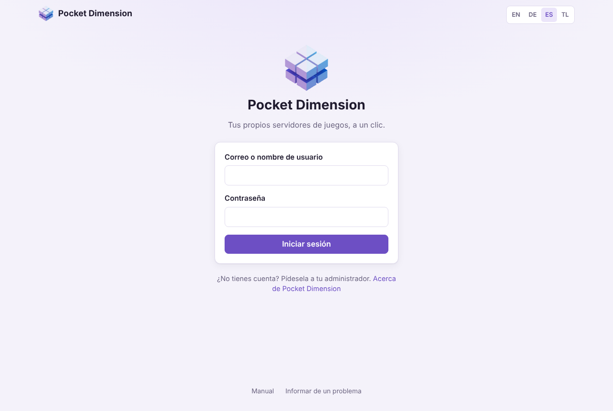
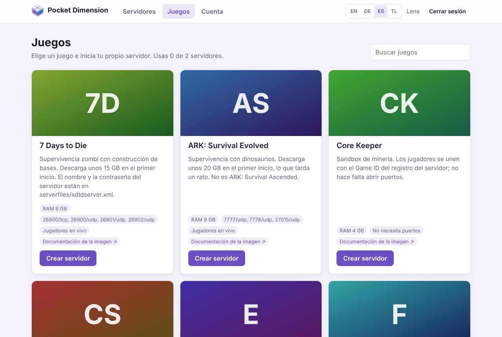
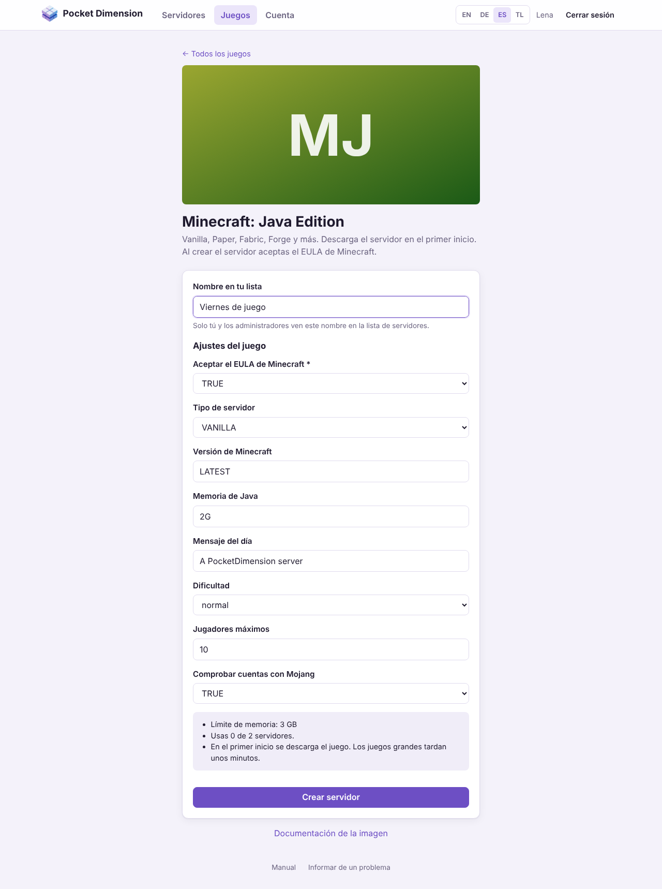
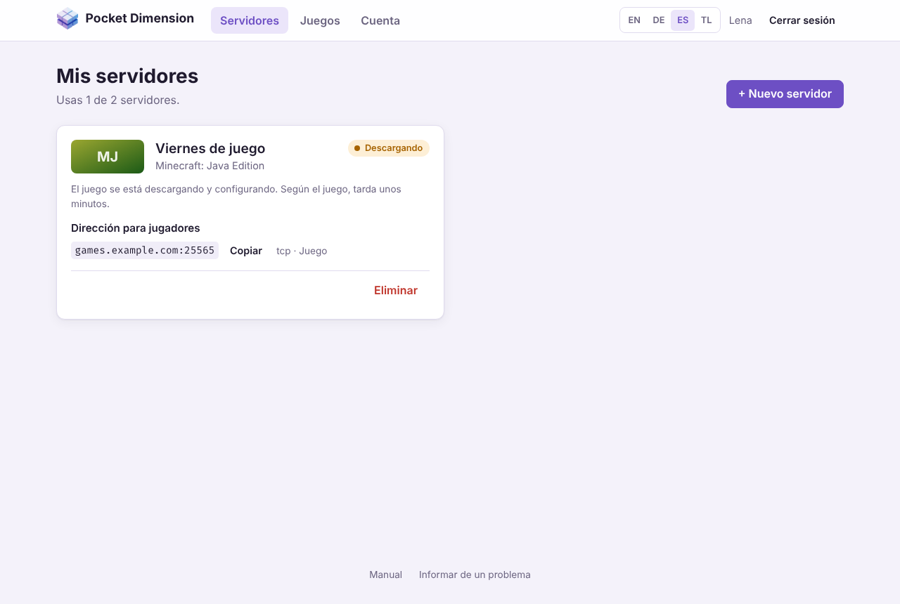
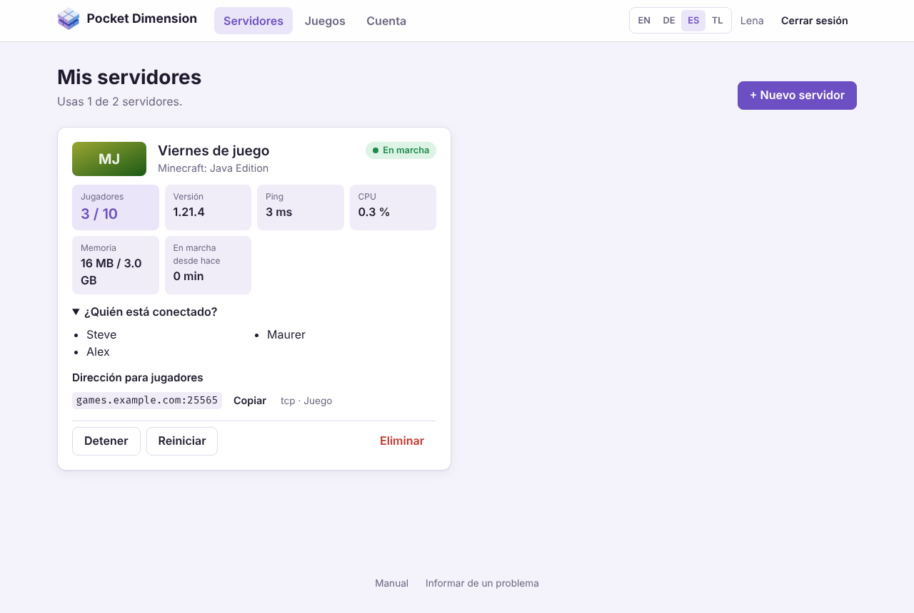
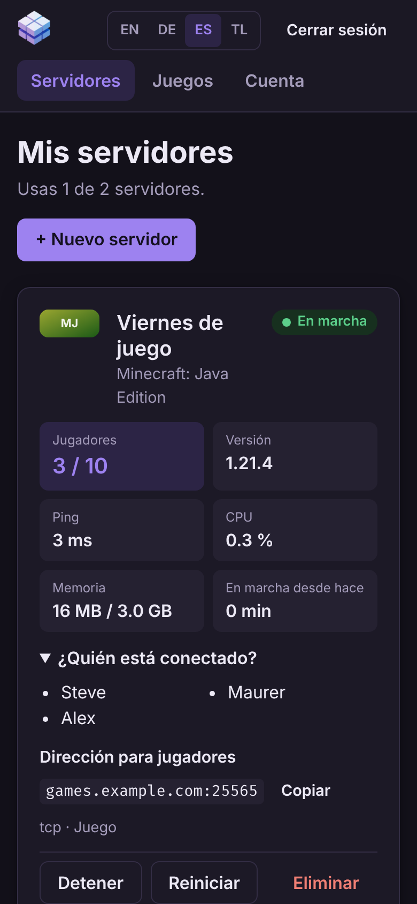
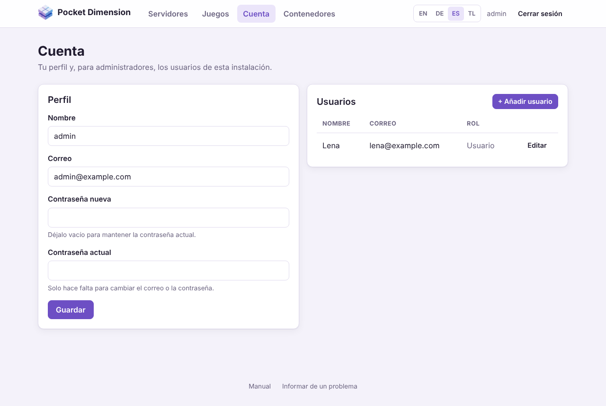
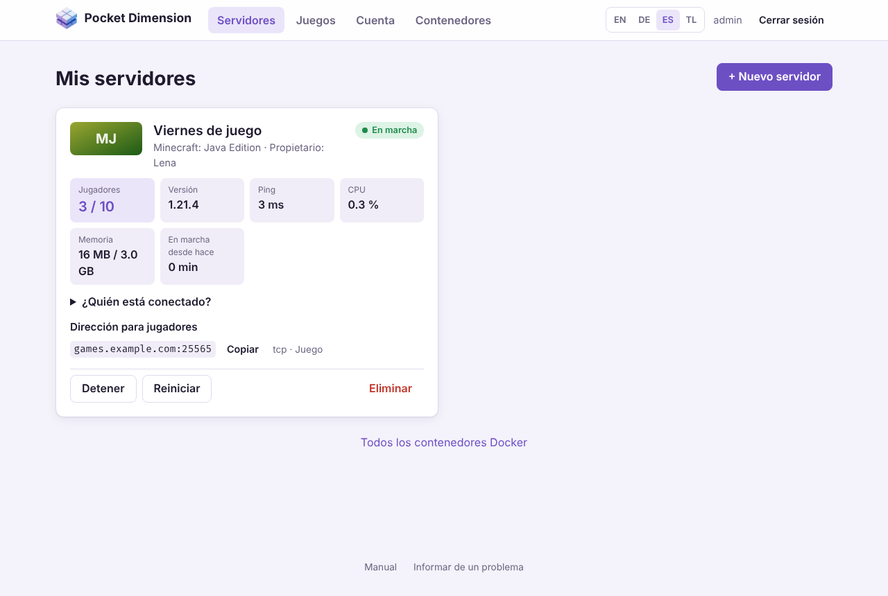
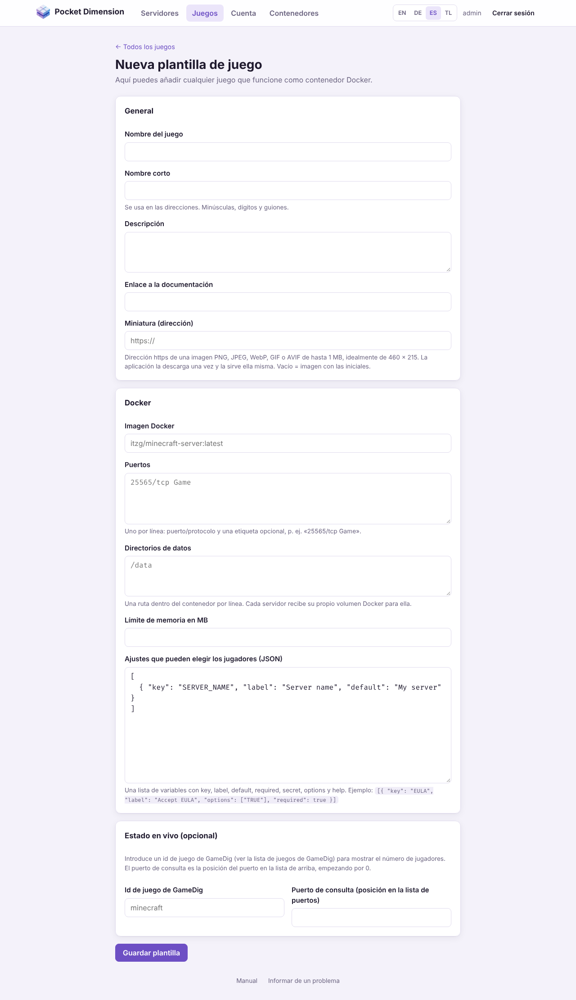
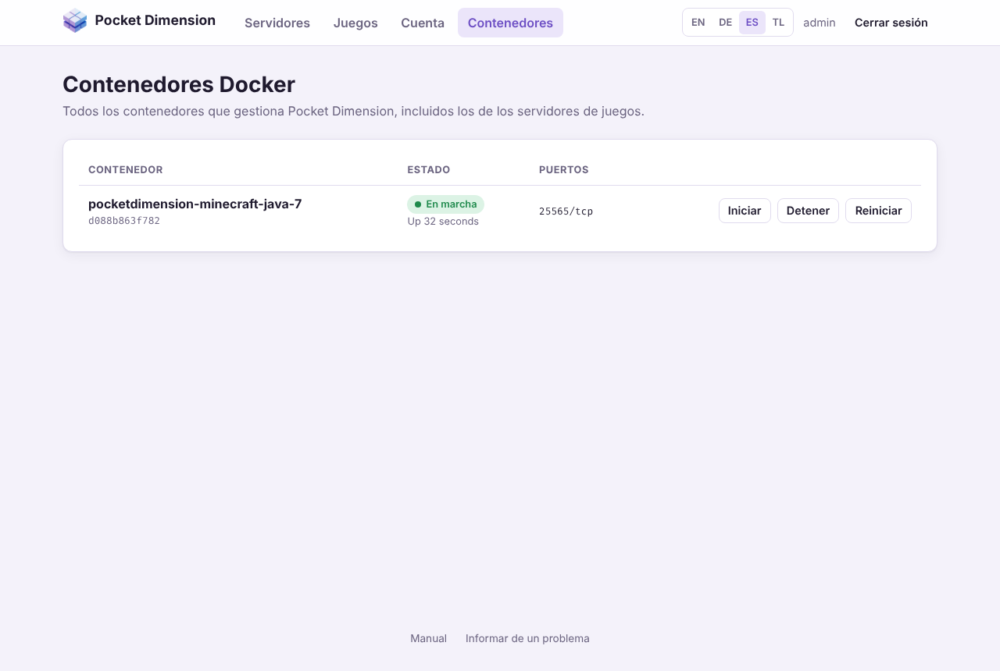

# Pocket Dimension – Manual de usuario

[English](../en/user-manual.md) · [Deutsch](../de/user-manual.md) · **Español** ·
[Tagalog](../tl/user-manual.md)

Con Pocket Dimension inicias tu propio servidor de juegos desde el navegador: eliges un juego,
escribes un nombre y listo. La aplicación descarga el juego, inicia el servidor y te muestra quién
está jugando. Nunca necesitas una línea de comandos.

Este manual explica cómo usar la aplicación, primero para todos los jugadores y después, en la
[Parte B](#parte-b--para-administradores), las secciones adicionales para administradores. Cómo
instalar y operar Pocket Dimension se explica en el [manual de operación](operator-manual.md).

> Las imágenes de este manual muestran un servidor de prueba. En tu instalación los juegos y las
> direcciones serán distintos, y los juegos de Steam muestran su portada en lugar de las iniciales.

## Contenido

- [De un vistazo](#de-un-vistazo)
- [Parte A – Para todos los jugadores](#parte-a--para-todos-los-jugadores)
  - [1. Iniciar sesión](#1-iniciar-sesión)
  - [2. Elegir un juego](#2-elegir-un-juego)
  - [3. Crear un servidor](#3-crear-un-servidor)
  - [4. Mis servidores](#4-mis-servidores)
  - [5. Invitar a tus amigos](#5-invitar-a-tus-amigos)
  - [6. Iniciar, detener y eliminar servidores](#6-iniciar-detener-y-eliminar-servidores)
  - [7. Cuenta y contraseña](#7-cuenta-y-contraseña)
  - [8. Preguntas frecuentes](#8-preguntas-frecuentes)
- [Parte B – Para administradores](#parte-b--para-administradores)
  - [9. Gestionar usuarios](#9-gestionar-usuarios)
  - [10. Todos los servidores](#10-todos-los-servidores)
  - [11. Activar y ajustar juegos](#11-activar-y-ajustar-juegos)
  - [12. Añadir un juego propio](#12-añadir-un-juego-propio)
  - [13. El catálogo compartido de juegos](#13-el-catálogo-compartido-de-juegos)
  - [14. Contenedores](#14-contenedores)

---

## De un vistazo

1. **Inicia sesión** con tu correo o nombre de usuario. La cuenta te la da el administrador.
2. Abre **Juegos** y haz clic en **Crear servidor** en el juego que quieras.
3. Escribe un nombre, revisa los ajustes y haz clic en **Crear servidor**.
4. En **Servidores**, espera hasta que tu servidor esté **En marcha**.
5. Copia la **Dirección para jugadores** y envíasela a tus amigos.

Arriba en cada página tienes **Servidores**, **Juegos** y **Cuenta** (los administradores ven
además **Contenedores**) y, a la derecha, el selector de idioma **EN / DE / ES / TL** y **Cerrar
sesión**. Abajo en cada página, **Manual** abre este texto e **Informar de un problema** abre las
incidencias del proyecto en GitHub.

---

# Parte A – Para todos los jugadores

## 1. Iniciar sesión



Abre la dirección que te dio tu administrador, por ejemplo `https://games.example.com` o
`http://192.168.0.10:3000`. Inicia sesión con tu **correo o nombre de usuario** y tu
**contraseña**.

Si tu instalación usa inicio de sesión único, la página de inicio de sesión muestra además un
botón como **Iniciar sesión con Keycloak**. Haz clic, entra en la página de inicio de sesión de tu
organización y vuelves con la sesión iniciada. Algunas instalaciones solo muestran este botón.

- **¿No tienes cuenta?** No puedes registrarte tú mismo. Pídesela al administrador de la
  instalación. Con inicio de sesión único, tu cuenta se crea la primera vez que entras.
- **Demasiados intentos fallidos:** después de 10 contraseñas incorrectas para la misma cuenta, la
  aplicación bloquea nuevos intentos durante un máximo de 15 minutos. El mensaje indica cuánto
  esperar.
- **¿Cuánto tiempo sigo conectado?** Un día de forma predeterminada. Después vuelves a iniciar
  sesión. El administrador puede cambiar este tiempo.
- **Idioma:** en tu primera visita la aplicación usa el idioma de tu navegador (inglés, alemán,
  español o tagalo; cualquier otro muestra inglés). Cámbialo con **EN / DE / ES / TL** arriba a la
  derecha; la aplicación recuerda tu elección.
- **Móvil y modo oscuro:** la interfaz se adapta a pantallas pequeñas y sigue el modo claro u
  oscuro de tu dispositivo.

Puedes cerrar sesión en cualquier momento con **Cerrar sesión**, arriba a la derecha. Tras un inicio
de sesión único, también cierra la sesión en el servicio de inicio de sesión.

## 2. Elegir un juego



**Juegos** muestra todos los juegos para los que puedes iniciar un servidor. El campo **Buscar
juegos** filtra por nombre y descripción, por ejemplo «mine» para Minecraft.

Cada tarjeta muestra:

| Dato                           | Significado                                                                                                                                          |
| ------------------------------ | ---------------------------------------------------------------------------------------------------------------------------------------------------- |
| Descripción                    | Qué es el juego y a qué prestar atención, por ejemplo el tamaño de la descarga.                                                                      |
| **RAM**                        | La memoria máxima que puede usar el servidor.                                                                                                        |
| Puertos (p. ej. `25565/tcp`)   | Los jugadores se conectan por estos puertos. **No necesita puertos** significa que el juego se conecta de otra forma (p. ej. con un Game ID).        |
| **Jugadores en vivo**          | La aplicación puede mostrar quién está conectado en este juego. Sin esta etiqueta solo ves si el servidor está en marcha y cuánta CPU y memoria usa. |
| **Documentación de la imagen** | La guía de la imagen del juego con todos sus ajustes, si quieres profundizar.                                                                        |

Arriba en la página ves cuántos servidores usas ya, por ejemplo «Usas 1 de 2 servidores.».

## 3. Crear un servidor



1. Haz clic en **Crear servidor** en el juego.
2. **Nombre en tu lista:** un nombre para reconocer el servidor, por ejemplo «Viernes de juego»
   (de 2 a 40 caracteres). Solo tú y los administradores ven este nombre; dentro del juego el
   servidor se llama como lo indiques en los ajustes del juego.
3. **Ajustes del juego:** lo que puedes ajustar aquí lo define la plantilla del juego, por ejemplo
   la dificultad, el número máximo de jugadores o una contraseña del servidor.
   - Los campos con `*` son obligatorios. Algunos juegos necesitan una contraseña del servidor
     (Valheim, Team Fortress 2) o un token de Steam (Counter-Strike 2). La descripción del juego
     te dice dónde conseguirlo.
   - Los campos de contraseña ocultan lo que escribes.
   - Los campos con lista desplegable solo ofrecen los valores permitidos.
   - En Minecraft, **TRUE** acepta el EULA de Minecraft. Sin él el servidor no arranca.
4. El recuadro de abajo resume cuánta memoria recibe el servidor y cuántos servidores usas ya.
5. Haz clic en **Crear servidor**. Llegas a **Servidores**.



Ahora la aplicación trabaja en segundo plano. La tarjeta muestra sucesivamente **En espera**,
**Descargando** y **Configurando**. Con el primer servidor de un juego, el equipo descarga el
juego; según el juego y la conexión tarda unos minutos, en Counter-Strike 2 (unos 60 GB) bastante
más. Mientras tanto puedes cerrar la página; el servidor se termina igualmente.

**Límite de servidores:** los jugadores sin derechos de administrador pueden tener un número
limitado de servidores, 2 de forma predeterminada. Al alcanzar el límite desaparece **Crear
servidor** y la aplicación te pide que elimines antes un servidor. Los servidores detenidos
también cuentan.

## 4. Mis servidores



En **Servidores** (página **Mis servidores**) cada uno de tus servidores es una tarjeta. La página
se actualiza sola: cada 3 segundos mientras se configura un servidor y, si no, cada 15 segundos.

### Estado

La etiqueta de color arriba a la derecha muestra qué está haciendo el servidor:

| Estado           | Significado                                                                                                 |
| ---------------- | ----------------------------------------------------------------------------------------------------------- |
| **En espera**    | La solicitud ha llegado y empieza enseguida.                                                                |
| **Descargando**  | El equipo está descargando el juego.                                                                        |
| **Configurando** | El servidor se está creando e iniciando por primera vez.                                                    |
| **En marcha**    | El servidor está encendido. Los juegos grandes suelen necesitar unos minutos más antes de poder conectarse. |
| **Detenido**     | El servidor está apagado. El mundo del juego se conserva.                                                   |
| **Reiniciando**  | El servidor se está reiniciando, o se cayó y Docker lo vuelve a iniciar.                                    |
| **Caído**        | El servidor ya no funciona y no puede reiniciarse solo. Prueba con **Iniciar**.                             |
| **Error**        | Algo falló durante la configuración. El mensaje de abajo explica el motivo.                                 |

### Valores en vivo

En los servidores en marcha, la tarjeta muestra:

- **Jugadores:** cuántos jugadores están conectados y cuántas plazas hay. **¿Quién está
  conectado?** muestra sus nombres si el juego los revela.
- **Mapa**, **Versión** y **Ping:** lo que el servidor informa sobre sí mismo. No todos los juegos
  informan de todo.
- **CPU** y **Memoria:** cuánta carga pone el servidor en el equipo ahora mismo. Tras la barra
  aparece el límite de memoria.
- **En marcha desde hace:** cuánto tiempo lleva encendido el servidor.

Jugadores, mapa y versión solo están disponibles en juegos con **Jugadores en vivo**. Son Minecraft
(Java y Bedrock), Valheim, Counter-Strike 2, Team Fortress 2, Rust, Project Zomboid, Satisfactory,
7 Days to Die, Enshrouded, V Rising, ARK: Survival Evolved, Sons of the Forest y OpenTTD. Terraria,
Factorio, Palworld, Core Keeper, Necesse y OpenRA solo muestran CPU, memoria y el estado.

Si dice **«El servidor todavía no responde»**, normalmente el juego aún está arrancando. Dale a los
juegos grandes unos minutos en su primer inicio.

### En el móvil



En el móvil los valores aparecen uno debajo de otro. Todos los botones funcionan igual que en el
ordenador.

## 5. Invitar a tus amigos

**Dirección para jugadores** muestra a qué se conectan tus amigos, por ejemplo
`games.example.com:25565`. **Copiar** pone la dirección en el portapapeles para que la envíes por
chat. Al lado ves para qué sirve el puerto (p. ej. `tcp · Game`).

- Tus amigos escriben la dirección en el juego al conectarse, normalmente en «Conexión directa»,
  «Añadir servidor» o en la búsqueda de servidores por IP.
- Si tienes varios servidores del mismo juego, cada uno recibe sus propios puertos. Un segundo
  servidor de Minecraft tiene entonces, por ejemplo, `:25575` en lugar de `:25565`. Asegúrate de
  compartir la dirección correcta.
- Si un juego tiene contraseña del servidor, dásela a tus amigos junto con la dirección. La
  aplicación no vuelve a mostrar las contraseñas después de crear el servidor, así que apúntalas.
- Los juegos sin puertos (p. ej. Core Keeper) se conectan con un Game ID del registro del servidor.
  Solo un administrador puede consultarlo; pídeselo.

Si tus amigos no consiguen entrar aunque el servidor esté **En marcha**, casi siempre se debe a la
configuración de red del equipo. Eso lo tiene que arreglar quien opera la instalación (ver el
[manual de operación](operator-manual.md#8-solución-de-problemas)).

## 6. Iniciar, detener y eliminar servidores

Los botones están en la parte inferior de cada tarjeta. Cuáles aparecen depende del estado.

| Botón          | Cuándo                     | Efecto                                                                                                        |
| -------------- | -------------------------- | ------------------------------------------------------------------------------------------------------------- |
| **Iniciar**    | El servidor está detenido  | Inicia el servidor. El mundo del juego sigue ahí.                                                             |
| **Detener**    | El servidor está en marcha | Apaga el servidor. El juego tiene hasta 30 segundos para guardar.                                             |
| **Reiniciar**  | El servidor está en marcha | Detiene e inicia el servidor; suele ayudar cuando se cuelga.                                                  |
| **Reintentar** | Estado **Error**           | Vuelve a intentar la configuración, por ejemplo tras una descarga interrumpida.                               |
| **Eliminar**   | Siempre                    | Elimina el servidor **con todas las partidas guardadas**. La aplicación pregunta antes. No se puede deshacer. |

Conviene saber:

- Un servidor detenido no usa memoria, pero sigue contando para tu límite de servidores.
- Cuando el equipo se reinicia, tus servidores vuelven a arrancar solos si estaban en marcha.
  Los servidores detenidos siguen apagados.
- Los ajustes de un servidor existente no se pueden cambiar después. Para ajustar otra cosa,
  elimina el servidor y créalo de nuevo (el mundo se pierde). Algunos juegos permiten cambios
  dentro del propio juego o en sus archivos de configuración; de eso puede encargarse un
  administrador.
- Solo quien opera la instalación puede hacer copias de seguridad de un servidor o moverlo a otro
  equipo.

## 7. Cuenta y contraseña

En **Cuenta → Perfil** puedes cambiar:

- **Nombre:** tu nombre de usuario para iniciar sesión y para mostrar (de 2 a 64 caracteres).
- **Correo**
- **Contraseña nueva:** al menos 10 caracteres. Déjala vacía para mantener la actual.

Para un correo nuevo o una contraseña nueva escribes además tu **Contraseña actual**. Después haz
clic en **Guardar**.

Al cambiar la contraseña se cierran todas tus otras sesiones, por ejemplo en otro dispositivo. El
dispositivo en el que la cambias sigue conectado.

**¿Olvidaste tu contraseña?** No hay recuperación por correo. Un administrador puede ponerte una
contraseña nueva en **Cuenta → Usuarios**.

**¿Entraste con inicio de sesión único?** Entonces tu correo y tu contraseña se gestionan en el
servicio de inicio de sesión. En tu perfil solo puedes cambiar el nombre.

## 8. Preguntas frecuentes

**Mi servidor se queda en «Descargando».**
Los juegos grandes tardan mucho la primera vez. El siguiente servidor del mismo juego arranca mucho
más rápido porque el juego ya está en el equipo. Si la descarga falla, la tarjeta muestra **Error**
y **Reintentar**.

**La tarjeta muestra «Error».**
Lee el mensaje de la tarjeta y haz clic en **Reintentar**. Si el error vuelve, pásale el mensaje a
un administrador.

**Arriba dice «Docker no está disponible».**
La aplicación no puede acceder a los servidores de juegos en este momento. Normalmente tus
servidores siguen funcionando. Avisa a quien opera la instalación.

**El servidor está en marcha, pero mis amigos no pueden entrar.**
Comprueba que usan la dirección correcta con el puerto y que los juegos grandes han terminado de
arrancar (los jugadores en vivo muestran entonces valores). Si no, normalmente los puertos no están
abiertos en el router o en el cortafuegos del equipo; eso lo configura quien opera la instalación.

**El número de jugadores es incorrecto o no aparece.**
Jugadores, mapa y versión los informa el propio juego. Algunos juegos los informan con retraso o
no los informan. La CPU y la memoria son correctas igualmente.

**No veo un juego que sí ve un amigo.**
Cada instalación tiene su propia selección. Un administrador puede activar juegos o añadir otros
nuevos (ver la [Parte B](#parte-b--para-administradores)).

**Mi servidor ha desaparecido.**
Un servidor solo desaparece si se eliminó. Los administradores pueden eliminar cualquier servidor;
pregúntales.

**He encontrado un error en la aplicación.**
Haz clic en **Informar de un problema** abajo en la página y describe qué pasó.

---

# Parte B – Para administradores

Los administradores ven todo lo que ven los jugadores y, además, las siguientes secciones. No
tienen límite de servidores.

> Los derechos de administrador equivalen a acceso a Docker en el equipo donde funciona Pocket
> Dimension. Dáselos solo a personas a las que confiarías el propio equipo (ver el
> [manual de operación, sección 4.5](operator-manual.md#45-qué-protege-la-aplicación-y-qué-no)).

## 9. Gestionar usuarios



En **Cuenta**, junto a tu perfil, la lista **Usuarios** muestra todas las demás cuentas.

- **Añadir usuario:** escribe nombre, correo y contraseña (al menos 10 caracteres). Marca
  **Administrador** para darle derechos de administrador a la cuenta. Después dale al nuevo usuario
  la dirección de la aplicación, su nombre y la contraseña; luego puede cambiarla él mismo.
- **Editar:** cambia el nombre, el correo, la contraseña o el rol de administrador de un usuario.
  Una contraseña nueva cierra la sesión del usuario en todos sus dispositivos.
- Tu propia cuenta la editas en **Perfil**, no en esta lista. Así no puedes quitarte por error tus
  propios derechos de administrador.
- Las cuentas no se pueden eliminar. Para bloquear a alguien, ponle una contraseña nueva que no
  conozca. Sus servidores se mantienen hasta que los elimines.

**Inicio de sesión único:** si la instalación lo usa, las personas reciben automáticamente una
cuenta de jugador la primera vez que entran. Que alguien sea administrador puede decidirlo entonces
el servicio de inicio de sesión; en ese caso, los cambios en la casilla **Administrador** de esta
lista se deshacen en el siguiente inicio de sesión de esa persona. Pregunta a quien gestiona la
instalación (ver la sección 9 del manual del operador).

## 10. Todos los servidores



Como administrador ves en **Servidores** los servidores de **todos** los usuarios. Tras el nombre
del juego aparece el **Propietario**. Puedes iniciar, detener, reiniciar y eliminar cualquier
servidor, por ejemplo si un servidor ralentiza el equipo o un jugador ya no participa.

Abajo en la página, **Todos los contenedores Docker** lleva a la página **Contenedores** (ver la
[sección 14](#14-contenedores)).

## 11. Activar y ajustar juegos

Cada tarjeta de juego en **Juegos** tiene para ti dos botones adicionales:

- **Desactivar / Activar:** los jugadores dejan de ver los juegos desactivados y nadie puede crear
  servidores nuevos con ellos. Tú los sigues viendo con la etiqueta **Desactivado**. Los servidores
  existentes del juego siguen funcionando.
- **Editar:** abre la plantilla del juego con todos sus campos (ver la
  [sección 12](#12-añadir-un-juego-propio)).

Los juegos del catálogo compartido (ver la [sección 13](#13-el-catálogo-compartido-de-juegos))
reciben actualizaciones desde allí. Lo que cambies en ellos se sobrescribe en cuanto llega una
versión más nueva del juego; la página de edición lo advierte. Para que un juego del catálogo sea
distinto de forma permanente, crea tu propia plantilla con otro nombre corto. Los juegos del
catálogo no se pueden eliminar, solo desactivar.

Tus propias plantillas puedes quitarlas con **Eliminar plantilla** en su página de edición, siempre
que ningún servidor las use.

Los cambios en una plantilla solo afectan a servidores **nuevos**. Los servidores existentes
conservan la imagen, los puertos y los ajustes con los que se crearon.

## 12. Añadir un juego propio



Se puede añadir cualquier juego que tenga una imagen Docker: **Juegos → + Nueva plantilla de
juego**. Los datos necesarios suelen estar en la descripción de la imagen en
[Docker Hub](https://hub.docker.com) o GitHub.

**General**

| Campo                     | Ejemplo                                                   | Significado                                                                                                                                                                |
| ------------------------- | --------------------------------------------------------- | -------------------------------------------------------------------------------------------------------------------------------------------------------------------------- |
| Nombre del juego          | `Minecraft Bedrock`                                       | Así aparece el juego en el catálogo.                                                                                                                                       |
| Nombre corto              | `minecraft-bedrock`                                       | Parte de la dirección y único; minúsculas, dígitos y guiones.                                                                                                              |
| Descripción               | `Servidor Bedrock para móvil y consola.`                  | Indicaciones para los jugadores: tamaño de descarga, campos obligatorios, cómo conectarse.                                                                                 |
| Enlace a la documentación | `https://github.com/itzg/docker-minecraft-bedrock-server` | Aparece en la tarjeta como **Documentación de la imagen**.                                                                                                                 |
| Miniatura (dirección)     | `https://…/header.jpg`                                    | Opcional. Dirección https de una imagen (PNG, JPEG, WebP, GIF o AVIF, máximo 1 MB, idealmente 460 × 215). La aplicación la descarga una vez. Vacío = imagen con iniciales. |

**Docker**

| Campo                                          | Ejemplo                                | Significado                                                                                                                                                                               |
| ---------------------------------------------- | -------------------------------------- | ----------------------------------------------------------------------------------------------------------------------------------------------------------------------------------------- |
| Imagen Docker                                  | `itzg/minecraft-bedrock-server:latest` | Imagen en Docker Hub o en otro registro.                                                                                                                                                  |
| Puertos                                        | `19132/udp Game`                       | Un puerto por línea: puerto dentro del contenedor, protocolo (`tcp` o `udp`) y una etiqueta opcional.                                                                                     |
| Directorios de datos                           | `/data`                                | Rutas dentro del contenedor donde el juego guarda mundos y ajustes. Cada servidor recibe su propio volumen para ellas. Incluye todos los directorios que la imagen declara como `VOLUME`. |
| Límite de memoria en MB                        | `2048`                                 | Un servidor no puede usar más memoria que esta.                                                                                                                                           |
| Ajustes que pueden elegir los jugadores (JSON) | ver abajo                              | Lo que los jugadores pueden ajustar al crear un servidor.                                                                                                                                 |

**Estado en vivo (opcional)**

| Campo                                                | Ejemplo | Significado                                                                                                                                                                                                         |
| ---------------------------------------------------- | ------- | ------------------------------------------------------------------------------------------------------------------------------------------------------------------------------------------------------------------- |
| Id de juego de GameDig                               | `mbe`   | Permite mostrar el número de jugadores, el mapa y la versión. El id está en la [lista de juegos de GameDig](https://github.com/gamedig/node-gamedig/blob/master/GAMES_LIST.md). Vacío = solo CPU, memoria y estado. |
| Puerto de consulta (posición en la lista de puertos) | `0`     | Qué puerto de la lista de arriba responde a las consultas, contando desde 0. Muchos juegos de Steam tienen un puerto propio para esto.                                                                              |

Los **ajustes que pueden elegir los jugadores** son una lista de variables de entorno de la imagen:

```json
[
	{ "key": "EULA", "label": "Accept the EULA", "options": ["TRUE"], "required": true },
	{ "key": "SERVER_NAME", "label": "Server name", "default": "Nuestro servidor" },
	{
		"key": "LEVEL_TYPE",
		"label": "World type",
		"options": ["DEFAULT", "FLAT"],
		"default": "DEFAULT"
	},
	{
		"key": "PASSWORD",
		"label": "Server password",
		"secret": true,
		"help": "Vacío = sin contraseña"
	}
]
```

| Clave      | Significado                                    |
| ---------- | ---------------------------------------------- |
| `key`      | Nombre de la variable de entorno de la imagen. |
| `label`    | Etiqueta en el formulario.                     |
| `default`  | Valor prellenado.                              |
| `required` | Los jugadores tienen que introducir un valor.  |
| `secret`   | Se introduce como campo de contraseña.         |
| `options`  | Lista desplegable en lugar de texto libre.     |
| `help`     | Indicación debajo del campo.                   |

Consejos:

- Los jugadores solo pueden ajustar las variables listadas aquí. La imagen, los puertos, los
  directorios de datos y el límite de memoria los decides solo tú.
- Los valores vacíos no se pasan a la imagen; se aplica el valor predeterminado de la imagen. Si una
  imagen tiene una contraseña predeterminada conocida (por ejemplo para RCON), haz el campo
  obligatorio.
- Las plantillas de juego no pueden montar carpetas del equipo, el socket de Docker ni privilegios
  especiales. Los juegos que necesitan algo así no se pueden añadir.
- Prueba un juego nuevo con un servidor propio antes de ponerlo a disposición de todos.

La interfaz muestra las etiquetas de los juegos del catálogo compartido traducidas al alemán, al
español y al tagalo. Las etiquetas de tus propios juegos aparecen tal como las escribes.

**Compartir con todos:** abajo en la página de edición, **Exportar para el catálogo** descarga el
juego como `<nombre-corto>.json`. Cómo llevarlo al catálogo compartido se explica en
[`catalog/README.md`](../../catalog/README.md).

## 13. El catálogo compartido de juegos

Todas las instalaciones de Pocket Dimension comparten un catálogo público de juegos en la carpeta
[`catalog/`](../../catalog/) del proyecto. La aplicación solo lo descarga, en modo lectura, sin
cuenta, sin clave y sin enviar datos sobre tu instalación.

Arriba en la página **Juegos** ves cuándo se consultó el catálogo por última vez y qué pasó:
cuántos juegos se añadieron y cuántos se actualizaron. **Actualizar catálogo** lo consulta en el
acto. Si no, la aplicación lo consulta al iniciarse y luego una vez al día.

- Los **juegos nuevos** del catálogo llegan **desactivados**. Los jugadores solo los ven cuando los
  activas. Así decides tú qué se ejecuta en tu equipo.
- Las **versiones más nuevas** de juegos conocidos (otra imagen, ajustes nuevos) se incorporan. Si
  un juego estaba activado o no, se mantiene.
- **Tus propios juegos** nunca se sobrescriben. Si un juego del catálogo tiene el mismo nombre
  corto que uno de los tuyos, se omite y se indica.
- Las **entradas no válidas** se omiten y se cuentan.
- Si dice «El catálogo compartido de juegos está desactivado», quien opera la instalación lo ha
  apagado. Entonces solo están los juegos incluidos con la aplicación y los tuyos.

## 14. Contenedores



**Contenedores** muestra todos los contenedores Docker que gestiona Pocket Dimension, con su estado
y sus puertos. El nombre del contenedor de un servidor de juegos tiene la forma
`pocketdimension-<nombre-corto>-<número>`. Quien opera la instalación lo necesita, por ejemplo,
para ver el registro de un juego con `docker logs <nombre-del-contenedor>` (para el Game ID de Core
Keeper o para mensajes de error).

**Iniciar**, **Detener** y **Reiniciar** controlan los contenedores directamente, también los que
no aparecen como servidores en la lista de servidores. Para los servidores de juegos normales, la
lista de servidores es la forma más cómoda.

---

¿Falta algo en este manual o hay algo incorrecto? Infórmalo en
[github.com/damaurer/PocketDimension/issues](https://github.com/damaurer/PocketDimension/issues).
