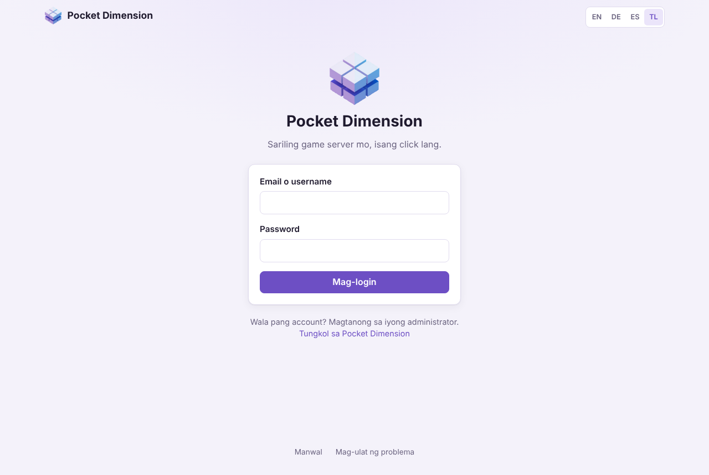
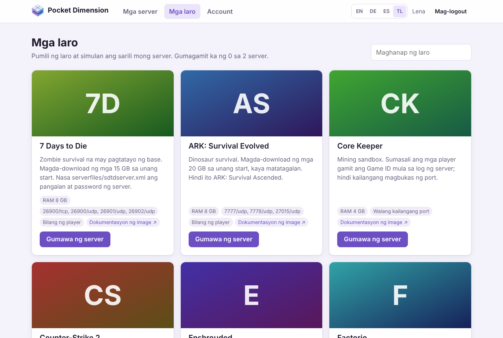
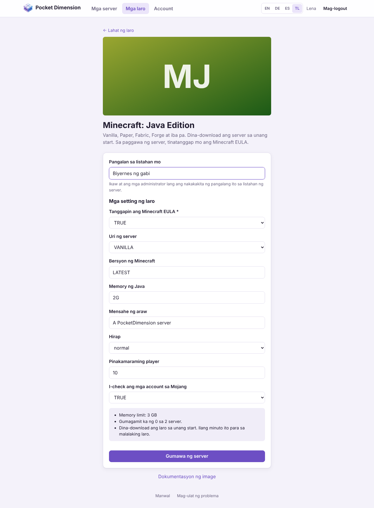
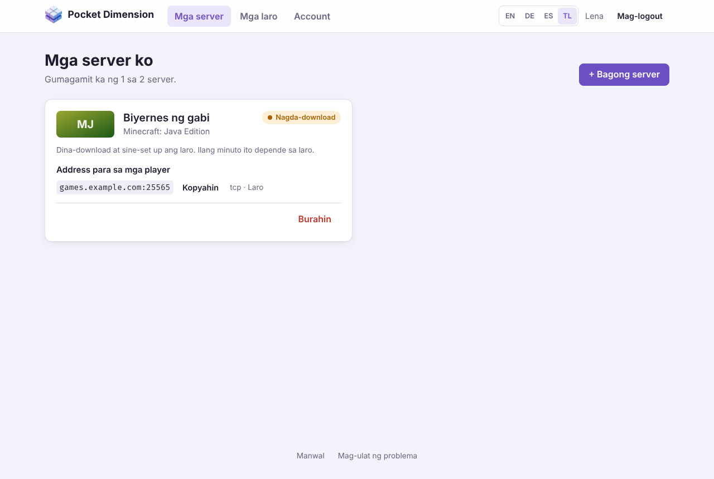
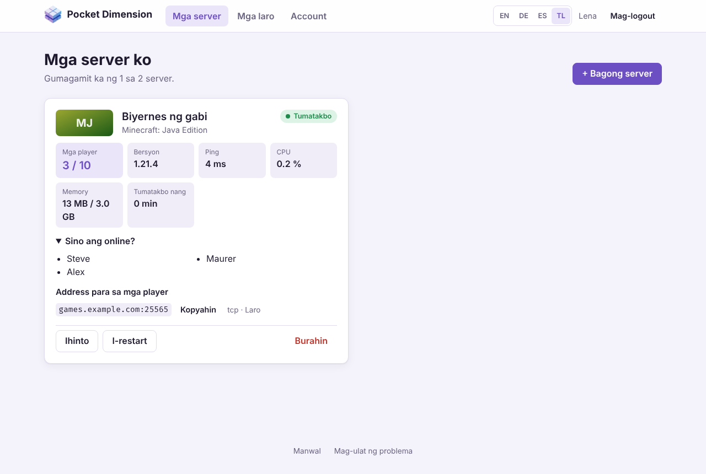
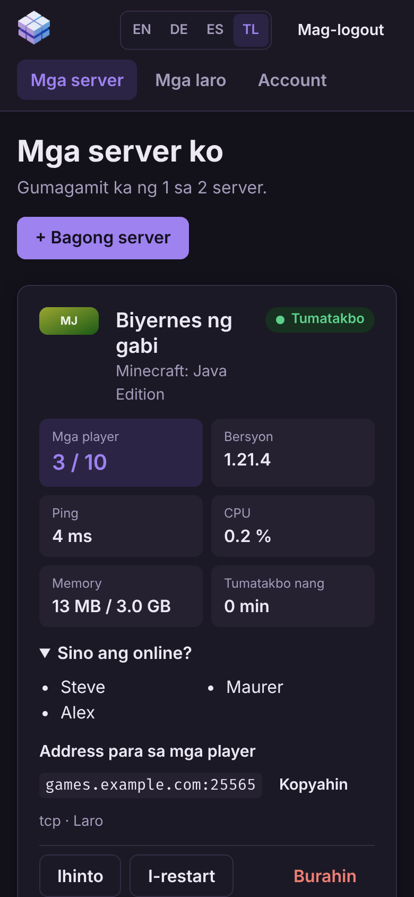
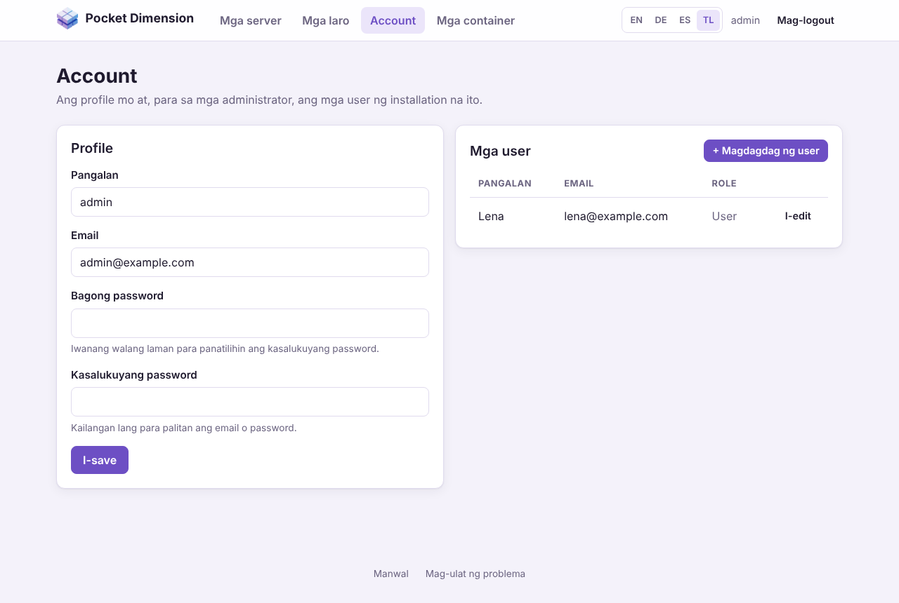
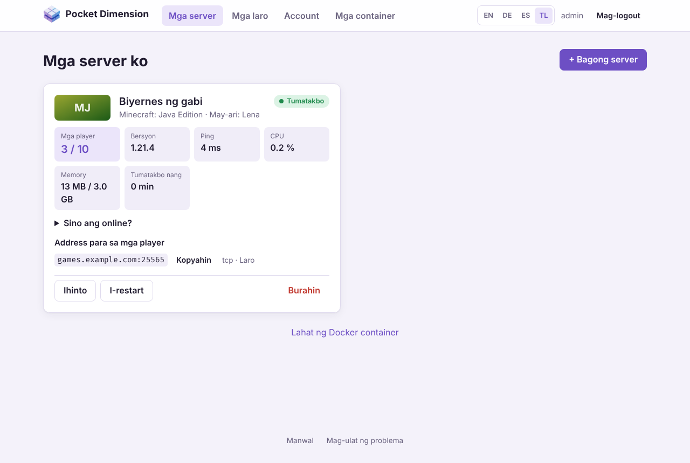
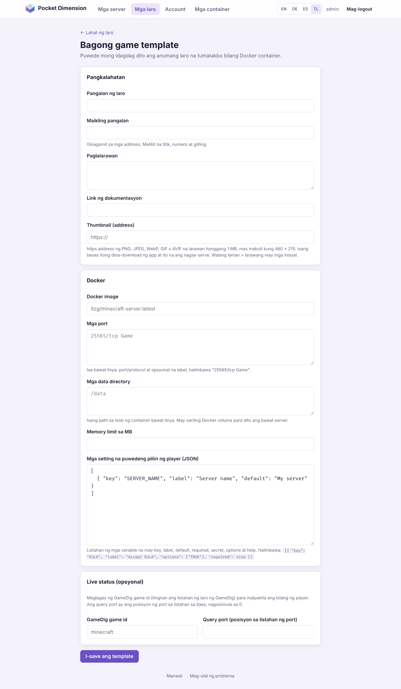
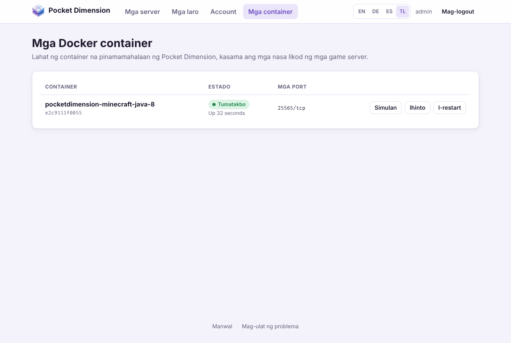

# Pocket Dimension – Manwal ng user

[English](../en/user-manual.md) · [Deutsch](../de/user-manual.md) ·
[Español](../es/user-manual.md) · **Tagalog**

Sa Pocket Dimension, puwede kang magbukas ng sarili mong game server mula sa browser: pumili ng
laro, maglagay ng pangalan, tapos na. Dina-download ng app ang laro, sinisimulan ang server at
ipinapakita kung sino ang naglalaro. Hindi mo kailangan ng command line.

Ipinapaliwanag ng manwal na ito kung paano gamitin ang app, una para sa lahat ng player, at sa
[Bahagi B](#bahagi-b--para-sa-mga-administrator) ang mga dagdag na bahagi para sa mga
administrator. Kung paano i-install at patakbuhin ang Pocket Dimension ay nasa
[manwal ng operator](operator-manual.md).

> Test server ang nasa mga larawan ng manwal na ito. Iba ang hitsura ng mga laro at address sa
> installation mo, at ang mga laro mula sa Steam ay may sariling cover sa halip na mga inisyal.

## Nilalaman

- [Sa isang tingin](#sa-isang-tingin)
- [Bahagi A – Para sa lahat ng player](#bahagi-a--para-sa-lahat-ng-player)
  - [1. Pag-login](#1-pag-login)
  - [2. Pagpili ng laro](#2-pagpili-ng-laro)
  - [3. Paggawa ng server](#3-paggawa-ng-server)
  - [4. Mga server ko](#4-mga-server-ko)
  - [5. Pag-imbita sa mga kaibigan](#5-pag-imbita-sa-mga-kaibigan)
  - [6. Pagsisimula, paghinto at pagbura ng server](#6-pagsisimula-paghinto-at-pagbura-ng-server)
  - [7. Account at password](#7-account-at-password)
  - [8. Mga madalas itanong](#8-mga-madalas-itanong)
- [Bahagi B – Para sa mga administrator](#bahagi-b--para-sa-mga-administrator)
  - [9. Pamamahala ng mga user](#9-pamamahala-ng-mga-user)
  - [10. Lahat ng server](#10-lahat-ng-server)
  - [11. Pag-enable at pag-aayos ng mga laro](#11-pag-enable-at-pag-aayos-ng-mga-laro)
  - [12. Pagdagdag ng sariling laro](#12-pagdagdag-ng-sariling-laro)
  - [13. Ang shared catalog ng mga laro](#13-ang-shared-catalog-ng-mga-laro)
  - [14. Mga container](#14-mga-container)

---

## Sa isang tingin

1. **Mag-login** gamit ang email o username mo. Ang administrator ang magbibigay sa iyo ng
   account.
2. Buksan ang **Mga laro** at i-click ang **Gumawa ng server** sa larong gusto mo.
3. Maglagay ng pangalan, tingnan ang mga setting, i-click ang **Gumawa ng server**.
4. Sa **Mga server**, hintaying **Tumatakbo** na ang server mo.
5. Kopyahin ang **Address para sa mga player** at ipadala sa mga kaibigan mo.

Sa itaas ng bawat pahina ay may **Mga server**, **Mga laro** at **Account** (nakikita rin ng mga
administrator ang **Mga container**), at sa kanan ang pagpili ng wika **EN / DE / ES / TL** at ang
**Mag-logout**. Sa ibaba ng bawat pahina, binubuksan ng **Manwal** ang tekstong ito at ng **Mag-ulat
ng problema** ang GitHub issues ng proyekto.

---

# Bahagi A – Para sa lahat ng player

## 1. Pag-login



Buksan ang address na ibinigay ng administrator mo, halimbawa `https://games.example.com` o
`http://192.168.0.10:3000`. Mag-login gamit ang **email o username** at ang **password** mo.

- **Wala pang account?** Hindi ka puwedeng mag-sign up nang mag-isa. Magtanong sa administrator
  ng installation.
- **Masyadong maraming maling subok:** pagkatapos ng 10 maling password para sa iisang account,
  hinaharangan ng app ang mga susunod na subok nang hanggang 15 minuto. Sinasabi ng mensahe kung
  gaano katagal maghihintay.
- **Gaano katagal akong naka-login?** Isang araw bilang default. Pagkatapos noon, mag-login ulit.
  Puwede itong baguhin ng administrator.
- **Wika:** sa unang bisita mo, ginagamit ng app ang wika ng browser mo (English, German, Spanish o
  Tagalog; English ang lalabas para sa iba). Palitan ito gamit ang **EN / DE / ES / TL** sa kanang
  itaas; tatandaan ng app ang pinili mo.
- **Phone at dark mode:** umaangkop ang interface sa maliliit na screen at sumusunod sa light o
  dark mode ng device mo.

Puwede kang mag-logout anumang oras gamit ang **Mag-logout** sa kanang itaas.

## 2. Pagpili ng laro



Nakalista sa **Mga laro** ang lahat ng larong puwede mong gawan ng server. Sinasala ng field na
**Maghanap ng laro** ayon sa pangalan at paglalarawan, halimbawa "mine" para sa Minecraft.

Ipinapakita ng bawat card ang:

| Bahagi                      | Kahulugan                                                                                                                                                                      |
| --------------------------- | ------------------------------------------------------------------------------------------------------------------------------------------------------------------------------ |
| Paglalarawan                | Kung anong laro ito at ano ang dapat bantayan, gaya ng laki ng download.                                                                                                       |
| **RAM**                     | Ang pinakamalaking memory na puwedeng gamitin ng server.                                                                                                                       |
| Mga port (hal. `25565/tcp`) | Dito kumokonekta ang mga player. Ang **Walang kailangang port** ay nangangahulugang iba ang paraan ng pagkonekta ng laro (hal. gamit ang Game ID).                             |
| **Bilang ng player**        | Kayang ipakita ng app kung sino ang online sa larong ito. Kung wala ang tag na ito, makikita mo lang kung tumatakbo ang server at gaano karaming CPU at memory ang gamit nito. |
| **Dokumentasyon ng image**  | Ang gabay para sa game image kasama ang lahat ng setting nito, kung gusto mong lumalim pa.                                                                                     |

Sa itaas ng pahina makikita mo kung ilang server na ang gamit mo, halimbawa "Gumagamit ka ng 1 sa
2 server."

## 3. Paggawa ng server



1. I-click ang **Gumawa ng server** sa laro.
2. **Pangalan sa listahan mo:** isang pangalan para makilala mo ang server, halimbawa
   "Biyernes ng gabi" (2 hanggang 40 character). Ikaw at ang mga administrator lang ang nakakakita
   ng pangalang ito; sa loob ng laro, ang pangalan ng server ay kung ano ang itinakda mo sa mga
   setting ng laro.
3. **Mga setting ng laro:** ang game template ang nagtatakda kung ano ang puwede mong baguhin dito,
   halimbawa ang hirap, ang pinakamaraming player o ang password ng server.
   - Kailangang punan ang mga field na may `*`. May mga larong nangangailangan ng password ng
     server (Valheim, Team Fortress 2) o ng Steam token (Counter-Strike 2). Sinasabi ng
     paglalarawan ng laro kung saan ito makukuha.
   - Itinatago ng mga password field ang tina-type mo.
   - Ang mga field na may drop-down list ay nag-aalok lang ng mga pinapayagang halaga.
   - Sa Minecraft, ang **TRUE** ay pagtanggap sa Minecraft EULA. Kung wala ito, hindi magsisimula
     ang server.
4. Ibinubuod ng kahon sa ibaba kung gaano karaming memory ang makukuha ng server at kung ilang
   server na ang gamit mo.
5. I-click ang **Gumawa ng server**. Mapupunta ka sa **Mga server**.



Nagtatrabaho na ngayon ang app sa background. Sunod-sunod na ipinapakita ng card ang
**Naghihintay**, **Nagda-download** at **Sine-set up**. Sa unang server ng isang laro, dina-download
ng computer ang laro; ilang minuto ito depende sa laro at sa koneksyon, at mas matagal pa para sa
Counter-Strike 2 (mga 60 GB). Puwede mong isara ang pahina habang naghihintay; matatapos pa rin
ang server.

**Limit ng server:** limitado ang bilang ng server na puwedeng magkaroon ang mga player na walang
admin rights, 2 bilang default. Kapag naabot mo ang limit, mawawala ang **Gumawa ng server** at
hihilingin ng app na magbura ka muna ng isang server. Kasama sa bilang ang mga nakahintong server.

## 4. Mga server ko



Sa **Mga server** (pahinang **Mga server ko**), isang card ang bawat server mo. Kusang nagre-refresh
ang pahina: bawat 3 segundo habang sine-set up ang isang server, at bawat 15 segundo kung hindi.

### Estado

Ipinapakita ng may-kulay na tag sa kanang itaas kung ano ang ginagawa ng server:

| Estado             | Kahulugan                                                                                        |
| ------------------ | ------------------------------------------------------------------------------------------------ |
| **Naghihintay**    | Dumating na ang request at magsisimula na.                                                       |
| **Nagda-download** | Dina-download ng computer ang laro.                                                              |
| **Sine-set up**    | Ginagawa ang server at sinisimulan sa unang pagkakataon.                                         |
| **Tumatakbo**      | Naka-on ang server. Kadalasang kailangan pa ng malalaking laro ng ilang minuto bago makakonekta. |
| **Nakahinto**      | Naka-off ang server. Nananatili ang mundo ng laro.                                               |
| **Nagre-restart**  | Nagre-restart ang server, o nag-crash ito at sinisimulan ulit ng Docker.                         |
| **Nag-crash**      | Hindi na tumatakbo ang server at hindi ito kusang makakapag-restart. Subukan ang **Simulan**.    |
| **Error**          | May nagkamali habang sine-set up. Ipinapaliwanag ng mensahe sa ibaba ang dahilan.                |

### Mga live na halaga

Para sa mga tumatakbong server, ipinapakita ng card ang:

- **Mga player:** ilan ang nakakonekta at ilan ang puwesto. Sa **Sino ang online?** nakalista ang
  mga pangalan nila kung ibinibigay ito ng laro.
- **Mapa**, **Bersyon** at **Ping:** ang iniuulat ng server tungkol sa sarili nito. Hindi lahat ng
  laro ay nag-uulat ng lahat.
- **CPU** at **Memory:** gaano kabigat ang server sa computer ngayon. Pagkatapos ng slash ay ang
  memory limit.
- **Tumatakbo nang:** gaano na katagal naka-on ang server.

Ang mga player, mapa at bersyon ay makikita lang sa mga larong may **Bilang ng player**. Ito ay ang
Minecraft (Java at Bedrock), Valheim, Counter-Strike 2, Team Fortress 2, Rust, Project Zomboid,
Satisfactory, 7 Days to Die, Enshrouded, V Rising, ARK: Survival Evolved, Sons of the Forest at
OpenTTD. Ang Terraria, Factorio, Palworld, Core Keeper, Necesse at OpenRA ay CPU, memory at estado lang ang
ipinapakita.

Kung nakasulat ang **"Hindi pa sumasagot ang server"**, kadalasang nagsisimula pa ang laro. Bigyan
ng ilang minuto ang malalaking laro sa unang start nila.

### Sa phone



Sa phone, magkakapatong ang mga halaga. Pareho lang ang gamit ng lahat ng button tulad sa computer.

## 5. Pag-imbita sa mga kaibigan

Ipinapakita ng **Address para sa mga player** kung saan kokonekta ang mga kaibigan mo, halimbawa
`games.example.com:25565`. Ilalagay ng **Kopyahin** ang address sa clipboard para maipadala mo sa
chat. Sa tabi nito makikita mo kung para saan ang port (hal. `tcp · Game`).

- Ilalagay ng mga kaibigan mo ang address sa laro kapag kumokonekta, kadalasan sa "Direct
  connect", "Add server" o sa paghahanap ng server gamit ang IP.
- Kung marami kang server ng iisang laro, may sariling port ang bawat isa. Halimbawa, `:25575` ang
  pangalawang Minecraft server sa halip na `:25565`. Siguraduhing tama ang address na ibinabahagi
  mo.
- Kung may password ang server ng laro, ibigay ito sa mga kaibigan mo kasama ng address. Hindi na
  ipinapakita ng app ang mga password pagkatapos gawin ang server, kaya isulat mo ito.
- Ang mga larong walang port (hal. Core Keeper) ay kumokonekta gamit ang Game ID mula sa log ng
  server. Administrator lang ang makakatingin nito; hingin ito sa kanila.

Kung hindi makapasok ang mga kaibigan mo kahit **Tumatakbo** ang server, halos palaging dahil ito
sa network setup ng computer. Ang operator ang dapat mag-ayos nito (tingnan ang
[manwal ng operator](operator-manual.md#8-pag-aayos-ng-problema)).

## 6. Pagsisimula, paghinto at pagbura ng server

Nasa ibaba ng bawat card ang mga button. Nakadepende sa estado kung alin ang lalabas.

| Button           | Kailan               | Epekto                                                                                               |
| ---------------- | -------------------- | ---------------------------------------------------------------------------------------------------- |
| **Simulan**      | Nakahinto ang server | Sinisimulan ang server. Nandoon pa rin ang mundo ng laro.                                            |
| **Ihinto**       | Tumatakbo ang server | Pinapatay ang server. May hanggang 30 segundo ang laro para mag-save.                                |
| **I-restart**    | Tumatakbo ang server | Hinihinto at sinisimulan ang server; kadalasang nakakatulong kapag nag-hang ito.                     |
| **Subukan ulit** | Estadong **Error**   | Sinusubukan ulit ang setup, halimbawa pagkatapos ng naputol na download.                             |
| **Burahin**      | Palagi               | Binubura ang server **kasama ang lahat ng save**. Magtatanong muna ang app. Hindi na ito maibabalik. |

Dapat malaman:

- Walang ginagamit na memory ang nakahintong server, pero kasama pa rin ito sa limit ng server mo.
- Kapag nag-restart ang computer, kusang magsisimula ulit ang mga server mo kung tumatakbo sila
  dati. Mananatiling naka-off ang mga nakahintong server.
- Hindi na mababago ang mga setting ng isang umiiral na server. Para magbago ng setting, burahin
  ang server at gawin ulit (mawawala ang mundo). May mga larong puwedeng baguhin sa loob mismo ng
  laro o sa kanilang mga configuration file; puwedeng asikasuhin iyon ng administrator.
- Ang operator lang ang puwedeng mag-back up ng server o maglipat nito sa ibang computer.

## 7. Account at password

Sa **Account → Profile** mo mapapalitan ang:

- **Pangalan:** ang username mo para sa pag-login at pagpapakita (2 hanggang 64 character).
- **Email**
- **Bagong password:** hindi bababa sa 10 character. Iwanang walang laman para panatilihin ang
  kasalukuyan.

Para sa bagong email o bagong password, ilagay din ang **Kasalukuyang password** mo. Pagkatapos,
i-click ang **I-save**.

Kapag pinalitan mo ang password, mala-logout ka sa lahat ng iba pang lugar, halimbawa sa ibang
device. Mananatiling naka-login ang device kung saan mo ito pinalitan.

**Nakalimutan ang password?** Walang "forgot password" sa email. Puwedeng magtakda ang
administrator ng bagong password para sa iyo sa **Account → Mga user**.

## 8. Mga madalas itanong

**Naiipit ang server ko sa "Nagda-download".**
Matagal ang malalaking laro sa unang pagkakataon. Mas mabilis magsimula ang susunod na server ng
parehong laro dahil nasa computer na ang laro. Kung pumalya ang download, ipapakita ng card ang
**Error** at **Subukan ulit**.

**"Error" ang nasa card.**
Basahin ang mensahe sa card at i-click ang **Subukan ulit**. Kung bumalik ang error, ipasa ang
mensahe sa administrator.

**Nakasulat sa itaas ang "Hindi maabot ang Docker".**
Hindi maabot ng app ang mga game server ngayon. Kadalasang tuloy pa rin ang takbo ng mga server mo.
Sabihan ang operator.

**Tumatakbo ang server, pero hindi makapasok ang mga kaibigan ko.**
Tingnan kung tama ang address nila kasama ang port, at kung tapos nang magsimula ang malalaking
laro (may mga halaga na ang bilang ng player). Kung hindi, kadalasang hindi bukas ang mga port sa
router o sa firewall ng computer; ang operator ang mag-aayos nito.

**Mali o wala ang bilang ng player.**
Ang laro mismo ang nag-uulat ng mga player, mapa at bersyon. May mga larong huli o hindi talaga
nag-uulat. Tama pa rin ang CPU at memory.

**Hindi ko makita ang larong nakikita ng kaibigan ko.**
May sariling pagpipilian ang bawat installation. Puwedeng mag-enable ng laro o magdagdag ng bago
ang administrator (tingnan ang [Bahagi B](#bahagi-b--para-sa-mga-administrator)).

**Nawala ang server ko.**
Nawawala lang ang server kapag binura ito. Puwedeng magbura ng kahit anong server ang mga
administrator; magtanong sa kanila.

**May nakita akong bug sa app.**
I-click ang **Mag-ulat ng problema** sa ibaba ng pahina at ilarawan ang nangyari.

---

# Bahagi B – Para sa mga administrator

Nakikita ng mga administrator ang lahat ng nakikita ng mga player, at dagdag pa ang mga sumusunod
na bahagi. Wala silang limit ng server.

> Ang admin rights ay katumbas ng access sa Docker sa computer kung saan tumatakbo ang Pocket
> Dimension. Ibigay lang ito sa mga taong pagkakatiwalaan mo sa mismong computer (tingnan ang
> [manwal ng operator, seksyon 4.5](operator-manual.md#45-ano-ang-pinoprotektahan-ng-app-at-ano-ang-hindi)).

## 9. Pamamahala ng mga user



Sa **Account**, katabi ng profile mo, ipinapakita ng listahang **Mga user** ang lahat ng iba pang
account.

- **Magdagdag ng user:** ilagay ang pangalan, email at password (hindi bababa sa 10 character).
  Lagyan ng tsek ang **Administrator** para bigyan ng admin rights ang account. Pagkatapos, ibigay
  sa bagong user ang address ng app, ang pangalan nila at ang password; puwede nilang palitan ang
  password pagkatapos.
- **I-edit:** palitan ang pangalan, email, password o admin role ng isang user. Mala-logout ang user
  sa lahat ng device kapag binigyan ng bagong password.
- Ang sarili mong account ay ine-edit mo sa **Profile**, hindi sa listahang ito. Sa ganitong paraan
  hindi mo maaalis nang hindi sinasadya ang sarili mong admin rights.
- Hindi nabubura ang mga account. Para pigilan ang isang tao, bigyan siya ng bagong password na
  hindi niya alam. Mananatili ang mga server niya hanggang burahin mo.

## 10. Lahat ng server



Bilang administrator, nakikita mo sa **Mga server** ang mga server ng **lahat** ng user. Pagkatapos
ng pangalan ng laro ay ang **May-ari**. Puwede mong simulan, ihinto, i-restart at burahin ang kahit
anong server, halimbawa kapag pinapabagal ng isang server ang computer o hindi na sumasali ang isang
player.

Sa ibaba ng pahina, dadalhin ka ng **Lahat ng Docker container** sa pahinang **Mga container**
(tingnan ang [seksyon 14](#14-mga-container)).

## 11. Pag-enable at pag-aayos ng mga laro

May dalawang dagdag na button para sa iyo ang bawat card ng laro sa **Mga laro**:

- **I-disable / I-enable:** hindi na nakikita ng mga player ang mga naka-disable na laro, at walang
  makakagawa ng bagong server gamit ang mga ito. Nakikita mo pa rin ang mga ito na may tag na
  **Naka-disable**. Tuloy pa rin ang takbo ng mga umiiral na server ng laro.
- **I-edit:** binubuksan ang game template kasama ang lahat ng field nito (tingnan ang
  [seksyon 12](#12-pagdagdag-ng-sariling-laro)).

Ang mga laro mula sa shared catalog (tingnan ang [seksyon 13](#13-ang-shared-catalog-ng-mga-laro))
ay tumatanggap ng update mula roon. Mapapalitan ang anumang binago mo sa mga ito kapag may dumating
na mas bagong bersyon ng laro; binabanggit ito ng pahina ng pag-edit. Para manatiling iba ang isang
laro mula sa catalog, gumawa ng sarili mong template na may ibang maikling pangalan. Hindi
nabubura ang mga laro mula sa catalog, puwede lang i-disable.

Puwede mong alisin ang sarili mong mga template gamit ang **Burahin ang template** sa pahina ng
pag-edit nito, basta walang server na gumagamit nito.

Ang mga pagbabago sa template ay para lang sa mga **bagong** server. Pinapanatili ng mga umiiral
na server ang image, mga port at mga setting na ginamit noong ginawa sila.

## 12. Pagdagdag ng sariling laro



Puwedeng idagdag ang kahit anong larong may Docker image: **Mga laro → + Bagong game template**.
Kadalasang makikita ang mga detalye sa paglalarawan ng image sa
[Docker Hub](https://hub.docker.com) o GitHub.

**Pangkalahatan**

| Field                 | Halimbawa                                                 | Kahulugan                                                                                                                                                                                    |
| --------------------- | --------------------------------------------------------- | -------------------------------------------------------------------------------------------------------------------------------------------------------------------------------------------- |
| Pangalan ng laro      | `Minecraft Bedrock`                                       | Ganito lalabas ang laro sa catalog.                                                                                                                                                          |
| Maikling pangalan     | `minecraft-bedrock`                                       | Bahagi ng address at natatangi; maliliit na titik, numero at gitling.                                                                                                                        |
| Paglalarawan          | `Bedrock server para sa phone at console.`                | Mga paalala para sa player: laki ng download, mga kailangang field, paano kumonekta.                                                                                                         |
| Link ng dokumentasyon | `https://github.com/itzg/docker-minecraft-bedrock-server` | Lalabas sa card bilang **Dokumentasyon ng image**.                                                                                                                                           |
| Thumbnail (address)   | `https://…/header.jpg`                                    | Opsyonal. https address ng larawan (PNG, JPEG, WebP, GIF o AVIF, hanggang 1 MB, mas mabuti kung 460 × 215). Isang beses itong dina-download ng app. Walang laman = larawang may mga inisyal. |

**Docker**

| Field                                           | Halimbawa                              | Kahulugan                                                                                                                                                                                                   |
| ----------------------------------------------- | -------------------------------------- | ----------------------------------------------------------------------------------------------------------------------------------------------------------------------------------------------------------- |
| Docker image                                    | `itzg/minecraft-bedrock-server:latest` | Image sa Docker Hub o sa ibang registry.                                                                                                                                                                    |
| Mga port                                        | `19132/udp Game`                       | Isang port bawat linya: port sa loob ng container, protocol (`tcp` o `udp`), at opsyonal na label.                                                                                                          |
| Mga data directory                              | `/data`                                | Mga path sa loob ng container kung saan sine-save ng laro ang mga mundo at setting. May sariling volume para dito ang bawat server. Ilista ang lahat ng directory na idinedeklara ng image bilang `VOLUME`. |
| Memory limit sa MB                              | `2048`                                 | Hindi puwedeng gumamit ang server ng mas maraming memory kaysa rito.                                                                                                                                        |
| Mga setting na puwedeng piliin ng player (JSON) | tingnan sa ibaba                       | Ang mga puwedeng itakda ng player kapag gumagawa ng server.                                                                                                                                                 |

**Live status (opsyonal)**

| Field                                     | Halimbawa | Kahulugan                                                                                                                                                                                                             |
| ----------------------------------------- | --------- | --------------------------------------------------------------------------------------------------------------------------------------------------------------------------------------------------------------------- |
| GameDig game id                           | `mbe`     | Para maipakita ng app ang bilang ng player, mapa at bersyon. Nasa [listahan ng laro ng GameDig](https://github.com/gamedig/node-gamedig/blob/master/GAMES_LIST.md) ang id. Walang laman = CPU, memory at estado lang. |
| Query port (posisyon sa listahan ng port) | `0`       | Kung aling port sa listahan sa itaas ang sumasagot sa mga query, nagsisimula sa 0. Maraming Steam game ang may hiwalay na port para rito.                                                                             |

Ang **mga setting na puwedeng piliin ng player** ay listahan ng mga environment variable ng image:

```json
[
	{ "key": "EULA", "label": "Accept the EULA", "options": ["TRUE"], "required": true },
	{ "key": "SERVER_NAME", "label": "Server name", "default": "Aming server" },
	{
		"key": "LEVEL_TYPE",
		"label": "World type",
		"options": ["DEFAULT", "FLAT"],
		"default": "DEFAULT"
	},
	{
		"key": "PASSWORD",
		"label": "Server password",
		"secret": true,
		"help": "Walang laman = walang password"
	}
]
```

| Key        | Kahulugan                                  |
| ---------- | ------------------------------------------ |
| `key`      | Pangalan ng environment variable ng image. |
| `label`    | Label sa form.                             |
| `default`  | Paunang halaga.                            |
| `required` | Kailangang maglagay ng halaga ang player.  |
| `secret`   | Ilalagay bilang password field.            |
| `options`  | Drop-down list sa halip na malayang text.  |
| `help`     | Paalala sa ilalim ng field.                |

Mga tip:

- Ang mga variable lang na nakalista rito ang puwedeng itakda ng mga player. Ikaw lang ang
  nagpapasya sa image, mga port, mga data directory at memory limit.
- Hindi ipinapasa sa image ang mga walang lamang halaga; ang default ng image ang gagamitin. Kung
  may kilalang default na password ang image (halimbawa para sa RCON), gawing required ang field.
- Hindi puwedeng mag-mount ang mga game template ng mga folder ng computer, ng Docker socket o ng
  mga espesyal na pribilehiyo. Hindi maidaragdag ang mga larong nangangailangan nito.
- Subukan muna ang bagong laro gamit ang sarili mong server bago ito ibigay sa lahat.

Ipinapakita ng interface ang mga label ng mga laro mula sa shared catalog na isinalin sa German,
Spanish at Tagalog. Ang mga label ng sarili mong mga laro ay lalabas kung paano mo isinulat.

**Ibahagi sa lahat:** sa ibaba ng pahina ng pag-edit, dina-download ng **I-export para sa catalog**
ang laro bilang `<maikling-pangalan>.json`. Kung paano ito ilalagay sa shared catalog ay nasa
[`catalog/README.md`](../../catalog/README.md).

## 13. Ang shared catalog ng mga laro

Iisang pampublikong catalog ng mga laro ang ginagamit ng lahat ng Pocket Dimension installation,
nasa folder na [`catalog/`](../../catalog/) ng proyekto. Dina-download lang ito ng app, read-only,
nang walang account, walang key at walang ipinapadalang data tungkol sa installation mo.

Sa itaas ng pahinang **Mga laro** makikita mo kung kailan huling tiningnan ang catalog at kung ano
ang nangyari: ilang laro ang nadagdag at ilan ang na-update. Agad itong tinitingnan ng **I-update ang
catalog**. Kung hindi, tinitingnan ito ng app pagsisimula at pagkatapos ay isang beses kada araw.

- Dumarating na **naka-disable** ang mga **bagong laro** mula sa catalog. Makikita lang ito ng mga
  player kapag in-enable mo. Sa ganitong paraan ikaw ang nagpapasya kung ano ang tatakbo sa
  computer mo.
- Kinukuha ang **mas bagong bersyon** ng mga kilalang laro (ibang image, bagong setting).
  Nananatili kung naka-enable o hindi ang laro.
- Hindi kailanman pinapalitan ang **sarili mong mga laro**. Kung may laro sa catalog na kapareho
  ng maikling pangalan ng isa sa mga laro mo, nilalaktawan ito at inililista.
- Hindi isinasama at binibilang ang mga **hindi wastong entry**.
- Kung nakasulat ang "Naka-off ang shared catalog ng mga laro", pinatay ito ng operator. Ang mga
  larong kasama ng app at ang sarili mong mga laro lang ang mayroon.

## 14. Mga container



Ipinapakita ng **Mga container** ang lahat ng Docker container na pinamamahalaan ng Pocket
Dimension, kasama ang estado at mga port. Ang pangalan ng container ng isang game server ay may
anyong `pocketdimension-<maikling-pangalan>-<numero>`. Kailangan ito ng operator, halimbawa para
tingnan ang log ng laro gamit ang `docker logs <pangalan-ng-container>` (para sa Game ID ng Core
Keeper o sa mga error message).

Direktang kinokontrol ng **Simulan**, **Ihinto** at **I-restart** ang mga container, kasama ang mga
hindi nakalista bilang server sa listahan ng server. Para sa mga karaniwang game server, mas
madaling gamitin ang listahan ng server.

---

May kulang o mali ba sa manwal na ito? I-ulat sa
[github.com/damaurer/PocketDimension/issues](https://github.com/damaurer/PocketDimension/issues).
